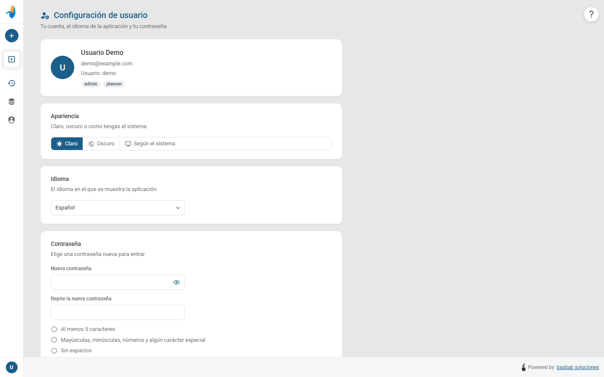
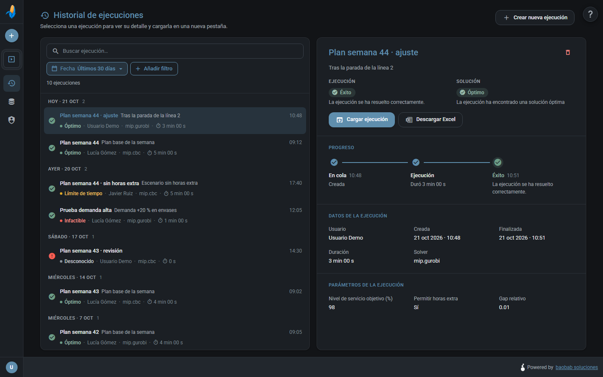
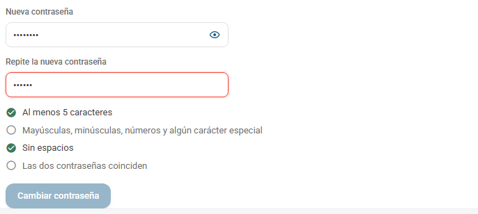

# Ajustes de usuario

La página **Configuración de usuario**: los datos de quien ha entrado, el idioma de la aplicación, el tema claro u oscuro y su contraseña. Se abre desde el usuario, al pie del menú lateral.

## Cómo se usa

- **Cuenta**: nombre, correo, nombre de usuario y roles de quien ha entrado. Solo se consultan.
- **Apariencia**: **Claro**, **Oscuro** o **Según el sistema**. La elección se guarda en el navegador.

  

- **Idioma**: el idioma de la aplicación, entre los que ofrece. Dura lo que la sesión: al volver a entrar, la aplicación abre en su idioma por defecto.
- **Contraseña**: la nueva dos veces. Mientras se escribe, la página marca lo que cumple: al menos 5 caracteres; mayúsculas, minúsculas, números y algún carácter especial; sin espacios; las dos iguales. **Cambiar contraseña** se activa cuando lo cumple todo.

  

## Cómo se activa

- **Core.** Siempre está.
- **Apariencia**: sale con `core.parameters.enableDarkMode: true` (apagado por defecto). Conviene encenderlo cuando las pantallas y dashboards propios del proyecto se leen bien en oscuro. Es para toda la aplicación, no por módulo.
- **Idiomas**: `languages` en `src/app/config.ts` (la plantilla ofrece inglés y español). La aplicación tiene inglés, español, francés y portugués. El idioma por defecto es `defaultLanguage` en `values.json` (o `VITE_APP_DEFAULT_LANGUAGE`).
- **Contraseña**: solo sale cuando se entra con usuario de Cornflow. Con Microsoft o Google la contraseña es la de esa cuenta.
- **Backend**: Cornflow (`GET /user/<id>/`, `PUT /user/<id>/` para la contraseña).

## Ver también

- [Inicio de sesión](inicio-de-sesion.md)
- [Gestión de roles](gestion-de-roles.md)
- Referencia técnica: *Dark mode* e *Internationalization configuration* del [README](../README.md#dark-mode).
