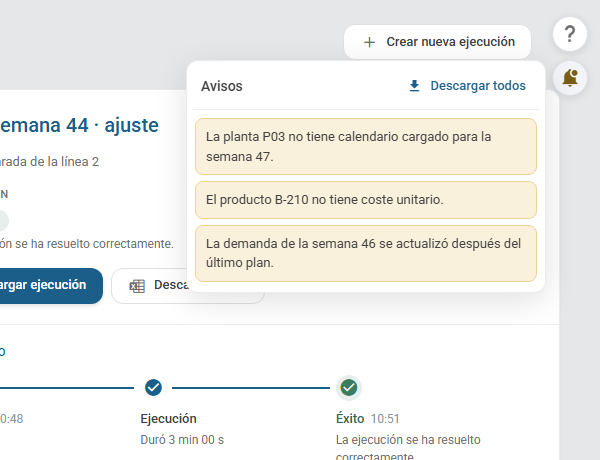

# Avisos

Una campana bajo el botón de ayuda reúne los avisos que manda el backend: datos que faltan, cargas que han fallado, cualquier cosa que el usuario deba saber al entrar.

## Cómo se usa

- La campana cambia de icono cuando hay avisos. Al pulsarla se abre el panel **Avisos** con la lista.
- **Descargar todos** baja los avisos en un fichero.
- Sin avisos, el panel dice "No hay avisos."

## Cómo se activa

- **Core.**
- **Configuración**: `core.parameters.enableWarnings: true` (apagado por defecto).
- **Backend**: necesita un backend propio que dé los avisos en `GET /external/warnings/` (una lista de `{ message }`) y el fichero en `GET /external/warnings/download/`. Sin ese backend no hay avisos que mostrar.

## Ver también

- [Aviso de entorno de pruebas](entorno-de-pruebas.md)
- [Ayuda](ayuda.md)
