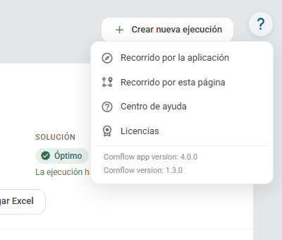
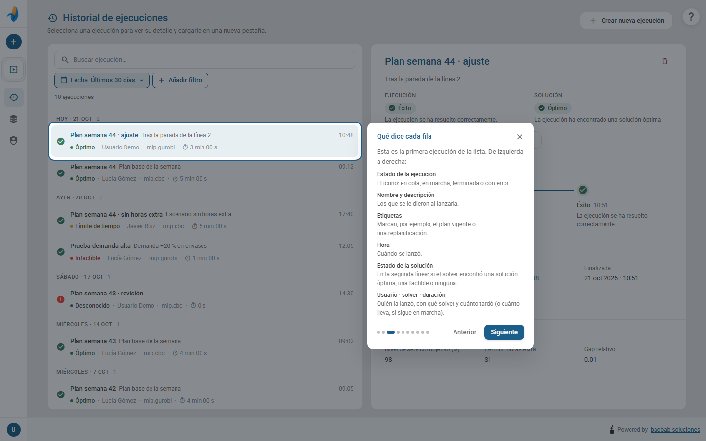
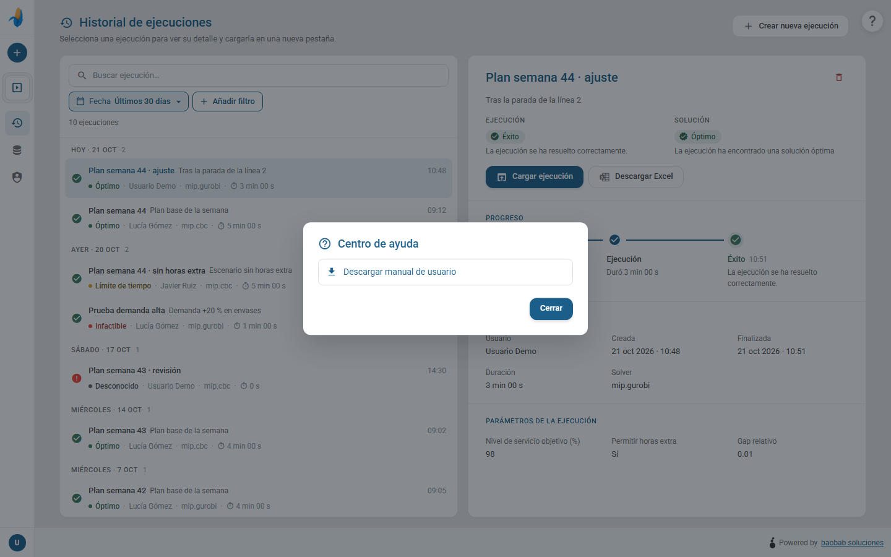
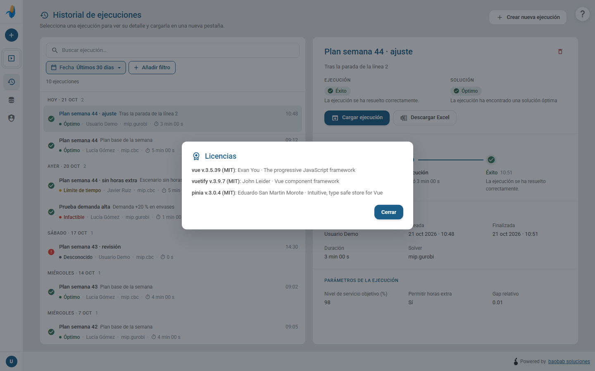

# Ayuda y recorridos guiados

El botón **?**, arriba a la derecha de cada pantalla, abre la ayuda: recorridos guiados por la aplicación y por la página en pantalla, el centro de ayuda con el manual y las licencias.

## Cómo se usa

- **Recorrido por la aplicación**: un paseo por el menú lateral, la nueva ejecución, la ejecución cargada, las pestañas, la ayuda y la cuenta.
- **Recorrido por esta página**: sale en las páginas que tienen uno (historial, nueva ejecución, tablas de datos, ajustes de usuario y gestión de roles). Explica cada parte de la pantalla, con ejemplos donde hace falta.

  El recorrido oscurece la pantalla y va paso a paso, con una tarjeta junto a cada parte. **Siguiente**, **Anterior** y **Terminar** lo manejan. Los pasos de lo que no está en pantalla se saltan.

  

- **Centro de ayuda**: los ficheros que pone el proyecto, como el manual de usuario en el idioma de la aplicación.

  

- **Licencias**: las librerías que usa la aplicación y sus licencias.

  

Al pie del menú salen la versión de la aplicación y la de Cornflow.

Los recorridos solo empiezan cuando el usuario los pide desde este menú.

## Cómo se activa

- **Core.** Siempre está.
- **Ficheros del centro de ayuda**: `helpMenuFiles` en `src/app/config.ts`. La plantilla trae el manual de usuario (`public/manual/user_manual_<idioma>.pdf`); el proyecto pone sus PDF en esa carpeta.
- **Backend**: las licencias y la versión de Cornflow vienen de Cornflow (`GET /licences/`, `GET /health/`).

## Ver también

- [Menú lateral](menu-lateral.md)
- [Avisos](avisos.md)
- Referencia técnica: *Help menu and guided tours* del [README](../README.md#help-menu-and-guided-tours).
