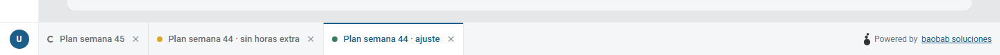

# Barra de pestañas

Al pie de la aplicación hay una pestaña por cada ejecución abierta. Sirve para tener varias ejecuciones a mano y pasar de una a otra sin volver al historial.

## Cómo se usa

- Una ejecución se abre al cargarla desde el [historial](historial-de-ejecuciones.md) o desde el [menú lateral](menu-lateral.md), o al lanzarla.
- Cada pestaña tiene un punto del color del estado de la ejecución. Una ejecución que se está resolviendo lleva una rueda que gira, y la pestaña se actualiza sola al terminar.
- Pulsar una pestaña la selecciona: sus datos pasan a ser los del menú lateral. Pulsar la seleccionada otra vez la deselecciona.
- La × cierra la pestaña. La ejecución sigue en el historial.
- Con el teclado, las flechas pasan de una pestaña a otra, Intro la selecciona y Suprimir la cierra.

## Cómo se activa

- **Core.** Siempre está.
- Con el módulo `latest-plan` de enterprise, la pestaña del plan actual lleva una ⭐.

## Ver también

- [Estados de una ejecución](estados-de-una-ejecucion.md)
- [Resumen de la ejecución](resumen-de-ejecucion.md)
