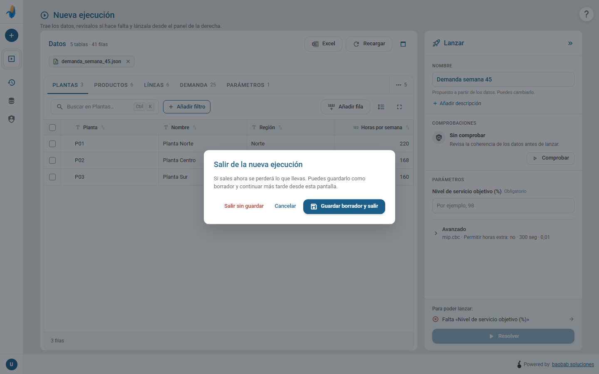
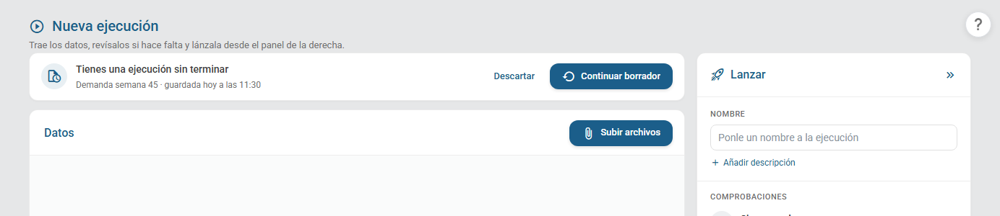

# Borrador de una ejecución

Si el usuario sale de la pantalla de nueva ejecución con datos cargados o cambios hechos, la aplicación le ofrece guardar lo que lleva como borrador y seguir más tarde.

## Cómo se usa

1. Al salir, el diálogo ofrece **Guardar borrador y salir**, **Salir sin guardar** o **Cancelar**.
2. Al volver a **Nueva ejecución**, un aviso recuerda el borrador: su nombre, cuándo se guardó y si tiene cambios sin aplicar.

   

3. **Continuar borrador** lo recupera tal como estaba; **Descartar** lo borra.

El borrador guarda los datos, los cambios sin aplicar y, si los datos vinieron de la base de datos, su revisión. Se guarda en el navegador: no se ve desde otro ordenador ni desde otro navegador. Hay uno por usuario y módulo.

## Cómo se activa

- **Core.** Siempre está.
- **Backend**: ninguno; el borrador vive en el navegador.

## Ver también

- [Crear una ejecución](crear-ejecucion.md)
