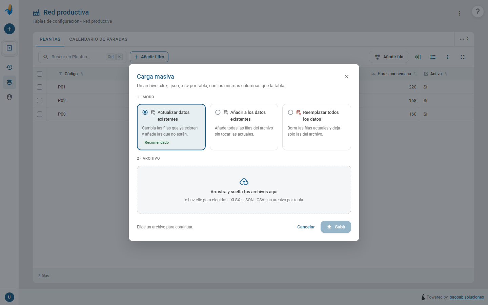

# Cargar todas las tablas maestras

Una sola carga para todas las tablas de configuración: el usuario sube uno o varios ficheros con los datos maestros y el backend los reparte entre sus tablas.

## Cómo se usa

1. En cualquier tabla de configuración, abrir el menú ⋮ junto al título y elegir **Cargar todas las tablas maestras**.
2. Elegir los ficheros (Excel, JSON o CSV) y el modo: **Actualizar datos existentes**, **Añadir a los datos existentes** o **Reemplazar todos los datos**.
3. Al terminar, la aplicación avisa: "Tablas maestras actualizadas correctamente". Si al reemplazar hay datos que dependen de los que se borran, el backend lo avisa y la aplicación pide confirmar antes de forzarlo.

## Cómo se activa

- **Core.**
- **Configuración**: `core.parameters.enableEditAllMasterTables: true` (apagado por defecto).
- **Backend**: necesita un backend propio que dé `POST /external/edit-all-tables/` con los ficheros y el modo. Sin él, la opción no funciona.

## Ver también

- [Tablas de configuración](tablas-de-configuracion.md)
