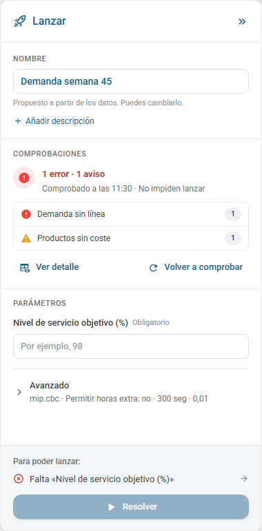
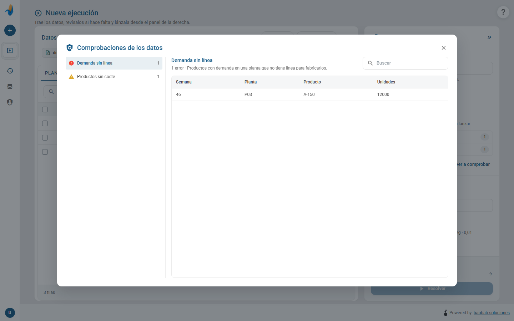
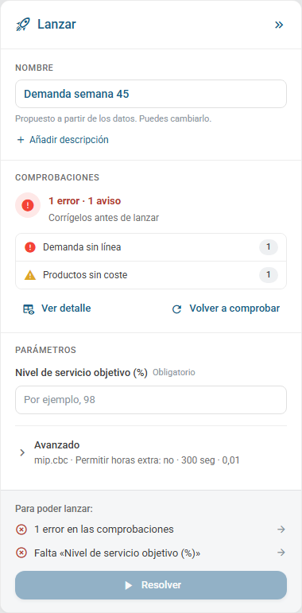

# Comprobaciones de datos

Antes de lanzar, el usuario puede pedir al modelo que revise la coherencia de los datos: demanda sin línea que la fabrique, productos sin coste… El resultado separa **errores** de **avisos**, y cada uno lleva a las filas que lo causan.

## Cómo se usa

1. Con los datos cargados, pulsar **Comprobar** en el panel de la derecha.
2. El panel dice "Comprobando datos…" y luego el resultado: "Sin incidencias", o cuántos errores y avisos hay, una línea por comprobación.
3. **Ver detalle** abre cada comprobación con sus filas:

   

4. Si se cambian los datos después, las comprobaciones quedan **desactualizadas** y se pueden repetir.

Las comprobaciones son opcionales: se puede lanzar sin hacerlas, y el panel solo lo recuerda. El proyecto puede hacer que los errores impidan lanzar hasta que se corrijan:

Las comprobaciones de una ejecución ya lanzada se ven en sus [validaciones](validaciones.md).

## Cómo se activa

- **Core.** Sale cuando el modelo define comprobaciones (`instance_checks` en su esquema).
- **Errores o avisos**: cada comprobación dice en el esquema si es un aviso (`is_warning: true`). Si no lo dice, es un error.
- **Que los errores bloqueen**: `core.parameters.enableBlockAdvanceOnCheckErrors: true` (apagado por defecto).
- **Backend**: Cornflow y el DAG. Las comprobaciones las calcula el modelo: la aplicación guarda los datos (`POST /instance/`) y pide las comprobaciones (`POST /data-check/instance/<id>/`), con el módulo y los parámetros elegidos.

## Ver también

- [Validaciones](validaciones.md)
- [Lanzar la ejecución](lanzar-ejecucion.md)
- Referencia técnica: *Data checks* del [README](../README.md#data-checks-enableblockadvanceoncheckerrors).
