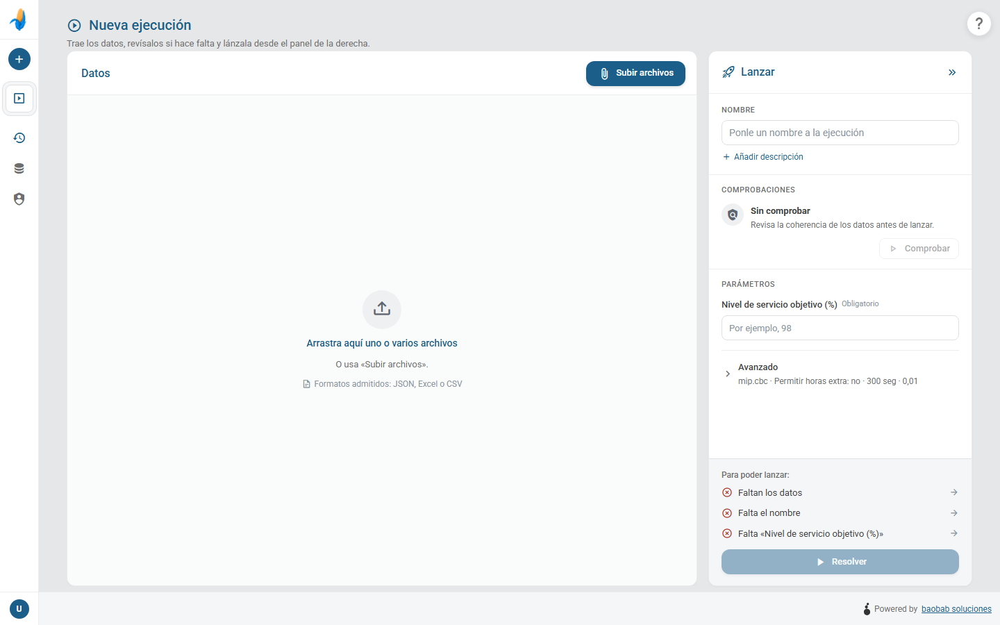
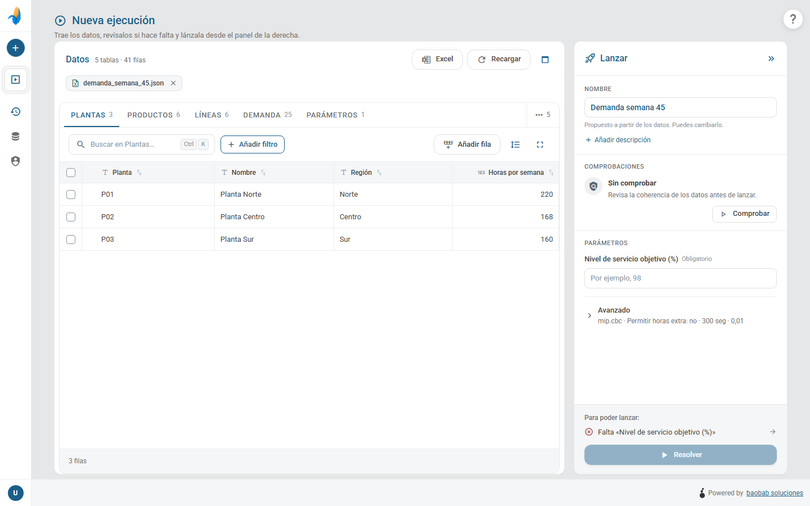

# Crear una ejecución

La pantalla para lanzar una ejecución nueva: se traen los datos, se revisan y corrigen si hace falta, se comprueban, se eligen los parámetros y se lanza. Todo en una página: los datos a la izquierda y el panel para lanzar a la derecha.

Con los datos cargados, la tabla ocupa la tarjeta de la izquierda y el panel dice qué falta para lanzar:

## Cómo se usa

1. **Traer los datos**: desde ficheros o, en enterprise, desde la base de datos. Ver [Carga de datos](carga-de-datos.md).
2. **Revisarlos**: cada tabla es una pestaña, y se puede editar como una hoja de cálculo. Si la tabla existe también en las tablas de configuración, se puede comparar con ella. Ver [Sincronización con tablas maestras](sincronizacion-con-tablas-maestras.md).
3. **Comprobarlos** (opcional): ver [Comprobaciones de datos](comprobaciones-de-datos.md).
4. **Elegir los parámetros** y, si hay varios, el solver: ver [Parámetros y solver](parametros-y-solver.md).
5. **Ponerle nombre y lanzar**: ver [Lanzar la ejecución](lanzar-ejecucion.md).

Si el usuario sale a medias, la aplicación ofrece guardar un borrador (ver [Borrador de una ejecución](borrador-de-ejecucion.md)). También se puede partir de una ejecución que ya existe (ver [Relanzar una ejecución](relanzar-ejecucion.md)).

El panel de la derecha se puede plegar en una tira que dice si la ejecución está lista o cuántas cosas faltan.

## Cómo se activa

- **Core.** Siempre está. Se llega con **Nueva ejecución** en el menú lateral o **Crear nueva ejecución** en el historial.
- **Roles**: se oculta a los roles que tengan prohibida la vista `project-execution`. Quién puede crear ejecuciones lo decide Cornflow.
- **Pantalla a medida**: un proyecto puede cambiar esta pantalla por la suya, con los mismos pasos y las mismas llamadas al backend (`core.parameters.createExecution.component`). Es una para toda la aplicación.
- **Backend**: Cornflow (`POST /instance/`, `POST /execution/`).

## Ver también

- [Historial de ejecuciones](historial-de-ejecuciones.md)
- Referencia técnica: *Create execution configuration* del [README](../README.md#create-execution-configuration) y [pantallas a medida](create-execution-flows.md) (en inglés).
