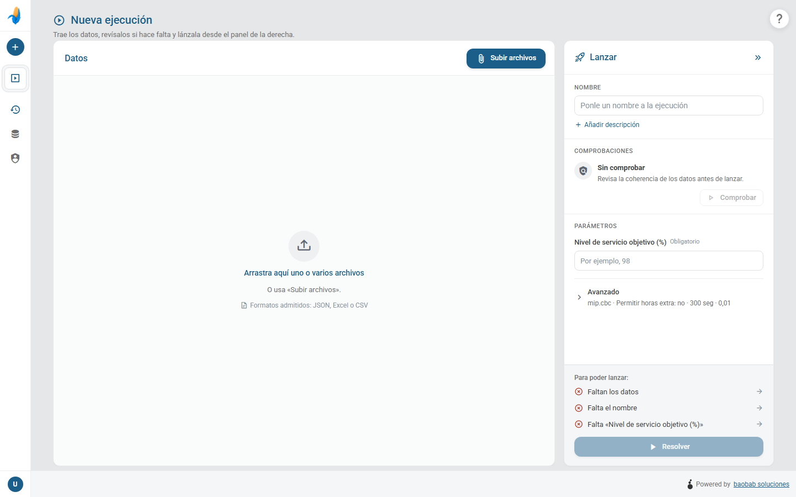
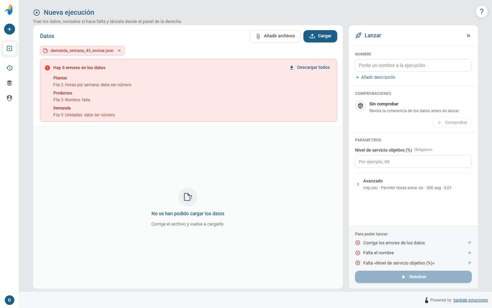

# Carga de datos

El primer paso de una ejecución nueva: traer sus datos. En core se suben uno o varios ficheros (Excel, JSON o CSV). Con enterprise, además, los datos pueden venir de la base de datos del cliente.

## Cómo se usa

1. Arrastrar los ficheros a la tarjeta de datos, o pulsar **Subir archivos**. Se pueden añadir más antes de cargar.
2. Pulsar **Cargar**. La cabecera dice cuántas tablas y filas se han cargado, y cada tabla sale en una pestaña.
3. Con varios ficheros, sus tablas se juntan en unos solos datos.

Si los datos no cumplen el formato que espera el modelo, la tarjeta lista los errores por tabla y por fila ("Fila 2: Horas por semana: debe ser número", "Fila 3: Nombre: falta") y **Descargar todos** los baja en un fichero. Hay que corregir el fichero y volver a cargarlo.

Una vez cargados, la cabecera de la tarjeta tiene:

- **Excel**: bajar los datos o sobrescribirlos con un Excel (que tiene que cumplir el formato).
- **Recargar**: volver a traer los datos.
- **Maximizar**: la tabla a pantalla completa.

## Cómo se activa

- **Core.** Siempre está.
- **Formatos**: `core.parameters.instanceFileFormats` limita los formatos que se aceptan (por defecto Excel, JSON y CSV). También admite `xls`, `xlsm` y `xlsb`.
- **Ficheros con formato especial**: `core.parameters.fileProcessors` aplica un tratamiento propio a los ficheros según cómo empieza su nombre. Ese tratamiento lo programa el proyecto.
- **Desde la base de datos**: es de **enterprise** (módulo `etl`) y necesita un backend con ETL. Ver la documentación de enterprise, *Carga desde la base de datos*. Ahí están también los filtros de carga (planta, fechas…) que se piden antes de traer los datos.
- **Backend**: en core los ficheros se leen en el navegador; no hace falta nada del backend hasta lanzar.

## Ver también

- [Crear una ejecución](crear-ejecucion.md)
- [Comprobaciones de datos](comprobaciones-de-datos.md)
- [Tablas de datos](tablas-de-datos.md): cómo se edita una tabla.
- Referencia técnica: *Instance upload file formats* y *Custom file processors* del [README](../../README.md#instance-upload-file-formats).
