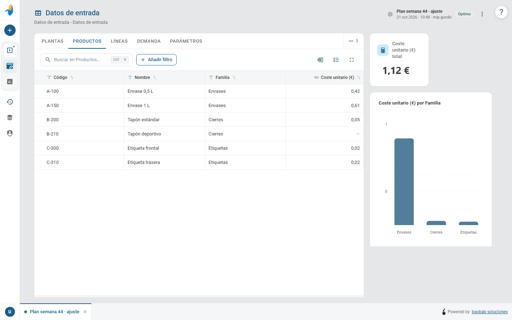
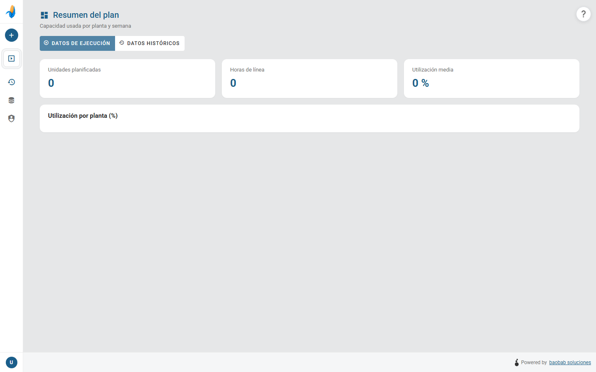

# Dashboards

Las vistas gráficas de una ejecución. Hay dos tipos: los **automáticos**, que la aplicación arma sola junto a una tabla a partir de sus columnas, y los **a medida**, que diseña cada proyecto para su caso.

**Dashboards automáticos.** Junto a la tabla salen tarjetas con totales y medias de sus columnas numéricas y gráficos de reparto por categoría, de evolución en el tiempo y, si hay coordenadas, un mapa.

**Dashboards a medida.** Son páginas propias del proyecto dentro de los datos de entrada o de los resultados, con los indicadores y gráficos que necesita cada cliente. Este es un ejemplo:

## Cómo se usa

- Los automáticos salen en la propia tabla de los datos de entrada o de los resultados: la tabla a la izquierda y los indicadores a la derecha, con más gráficos debajo.
- Los a medida son una página más del menú lateral, dentro de **Datos de entrada** o **Resultados**.

## Cómo se activa

- **Core.**
- **Automáticos**: `core.parameters.enableAutoInstanceDashboard` (datos de entrada) y `enableAutoSolutionDashboard` (resultados), apagados por defecto. `core.parameters.tableDashboards` los enciende o apaga tabla a tabla. Los gráficos se eligen solos según los datos: sin tarjetas si la tabla tiene más de seis columnas numéricas, un gráfico de reparto si una columna tiene entre 2 y 10 categorías… El mapa necesita conexión a internet (usa los mapas de OpenStreetMap).
- **A medida**: los programa el proyecto. Se añaden al menú con `dashboardPages` (resultados) e `instanceDashboardPages` (datos de entrada), y a la aplicación con `dashboardRoutes` e `instanceDashboardRoutes`. Cada uno puede reservarse a unos roles o a unos módulos.
- **Varios módulos**: cada módulo puede tener sus propios dashboards (`core.schemaOverrides`).
- **Backend**: los datos de la ejecución en Cornflow. Un dashboard a medida puede usar además endpoints propios del proyecto.

## Ver también

- [Histórico en dashboards](historico-en-dashboards.md)
- [KPIs](kpis.md)
- Referencia técnica: [dashboards automáticos](../AUTO_DASHBOARDS_README.md) (en inglés).
