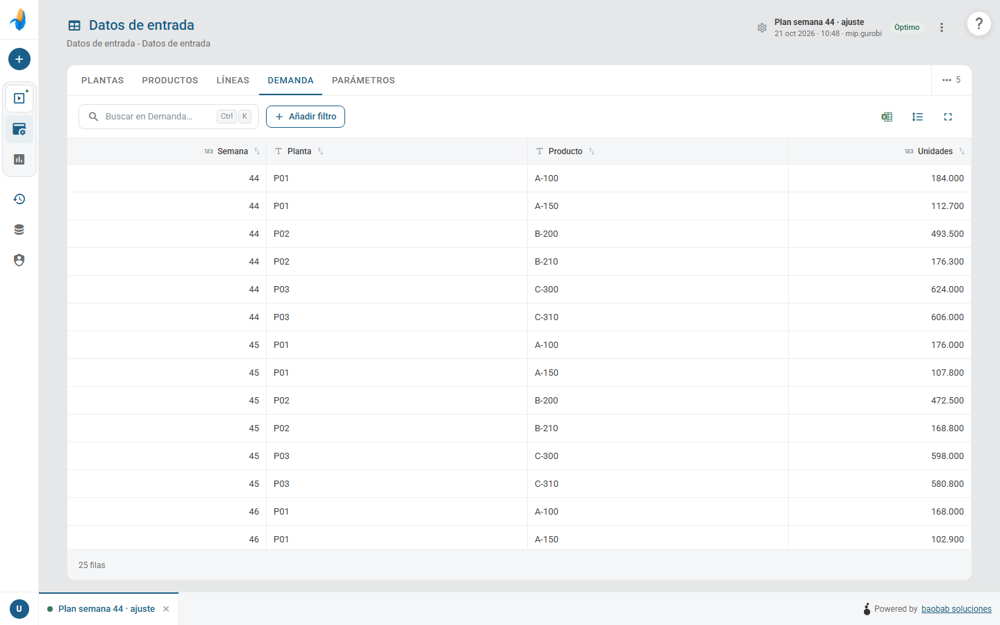
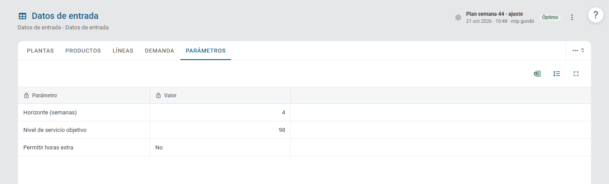
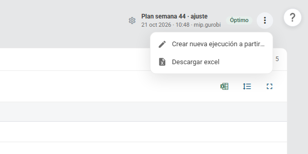

# Datos de entrada

Los datos con los que se resolvió la ejecución cargada: una pestaña por tabla, para consultarlos, buscarlos, filtrarlos y descargarlos. Aparecen en el menú lateral, dentro de la ejecución cargada.

## Cómo se usa

- **Datos de entrada** reúne todas las tablas del modelo, cada una en su pestaña con su número de filas. Sobre cada tabla están la búsqueda, los filtros, la descarga a Excel y la pantalla completa (ver [Tablas de datos](tablas-de-datos.md)).
- Una tabla de un solo registro (por ejemplo, los parámetros generales) se ve como una lista de campos y valores:

  

- **Validaciones** reúne las comprobaciones del modelo que encontraron algo (ver [Validaciones](validaciones.md)).
- El menú ⋮ junto al título tiene **Descargar excel**, que baja todas las tablas de entrada en un fichero, y **Crear nueva ejecución a partir de los datos de entrada actuales** (ver [Relanzar una ejecución](relanzar-ejecucion.md)).

  

Los datos de una ejecución no se editan en su sitio: para cambiarlos se lanza una ejecución nueva a partir de ellos. (Con el módulo `recalculation` de enterprise sí se pueden editar; ver *Recálculo de la solución* en la documentación de enterprise).

## Cómo se activa

- **Core.** Sale en cuanto hay una ejecución cargada.
- **Qué tablas salen**: las del esquema de datos del modelo. Una tabla con `visible: false` en el esquema no sale ni se descarga, pero sus datos siguen disponibles para los dashboards. Una columna con `visible: false` tampoco sale.
- **Tablas que el esquema no declara**: salen solo con `core.parameters.showTablesWithoutSchema: true` (apagado por defecto).
- **Dashboards**: el proyecto puede añadir dashboards a los datos de entrada (`instanceDashboardPages`) o activar los automáticos (ver [Dashboards](dashboards.md)).
- **Título del grupo**: `core.parameters.sectionTitles.inputData`.
- **Roles**: se oculta a los roles que tengan prohibida la vista `input-data`.
- **Backend**: Cornflow (`GET /instance/<id>/data/`).

## Ver también

- [Resultados](resultados.md)
- [Validaciones](validaciones.md)
- [Tablas de datos](tablas-de-datos.md)
- Referencia técnica: *Input data section* del [README](../../README.md#input-data-section).
