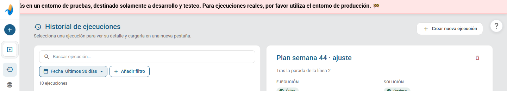

# Aviso de entorno de pruebas

Una franja en lo alto de la aplicación avisa de que el entorno es de pruebas, para que nadie lance ahí ejecuciones reales.

El texto se desplaza por la franja: "Estás en un entorno de pruebas, destinado solamente a desarrollo y testeo. Para ejecuciones reales, por favor utiliza el entorno de producción."

## Cómo se activa

- **Core.**
- **Configuración del despliegue**: `isStagingEnvironment: true` en `values.json` (o `VITE_APP_IS_STAGING_ENVIRONMENT=true`). Por defecto está apagado. Se activa en cada despliegue, sin tocar el código: en preproducción sí, en producción no.
- No sale en la pantalla de inicio de sesión.

## Ver también

- [Avisos](avisos.md)
- Referencia de configuración: *Configuration reference* del [README](../../README.md#configuration-reference).
