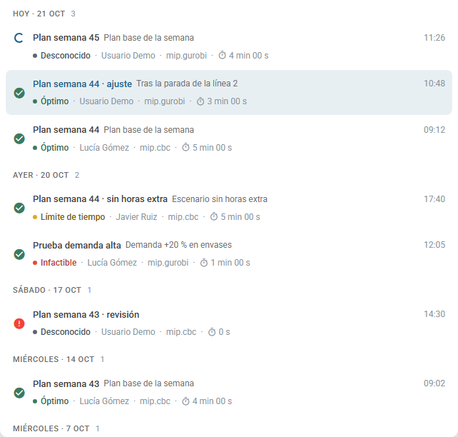

# Estados de una ejecución

Cada ejecución tiene dos estados: el de la **ejecución** (si el proceso terminó bien, está en marcha o falló) y el de la **solución** (qué encontró el solver). Salen en el historial, en las pestañas, en el menú lateral y en el resumen de la ejecución, siempre con los mismos colores.

## Cómo se usa

**Estado de la ejecución**

| Estado | Qué quiere decir |
| --- | --- |
| Éxito | La ejecución terminó y se resolvió, o se cargó a mano una solución |
| Cargando (rueda) | Se está resolviendo |
| Cargando (reloj) | Está en cola, esperando a empezar |
| Error | Falló, se paró, no pudo empezar o no pudo guardar el resultado. El detalle muestra el mensaje del servidor |
| No ejecutado por el usuario | Se creó sin resolver |

**Estado de la solución**

| Estado | Qué quiere decir |
| --- | --- |
| Óptimo | El solver encontró la mejor solución |
| Factible | Encontró una solución válida, sin demostrar que sea la mejor |
| Límite de tiempo, de memoria o de nodos | Se paró al llegar a un límite |
| Infactible | No hay solución que cumpla todas las restricciones |
| No acotado | El problema no tiene límite |
| No resuelto, Desconocido | No hay solución o no se sabe |
| Problema de licencia | El solver no tenía licencia |

Al dejar el ratón sobre un estado se ve su explicación.

## Cómo se activa

- **Core.** Siempre está.
- **Nombres, colores e iconos**: `core.parameters.executionStates` y `solutionStates`, por código de estado. Un proyecto puede renombrar un estado o cambiar su color. Las ejecuciones en marcha y en cola se ven igual en todas las aplicaciones.
- **Backend**: los estados los da Cornflow.

## Ver también

- [Historial de ejecuciones](historial-de-ejecuciones.md)
- [Barra de pestañas](barra-de-pestanas.md)
- Referencia técnica: *executionStates / solutionStates* del [README](../../README.md#executionstates--solutionstates).
