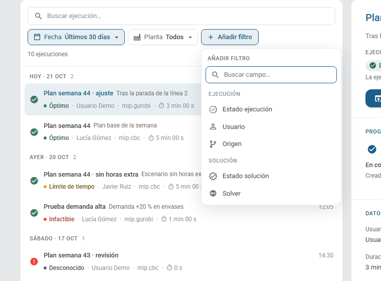
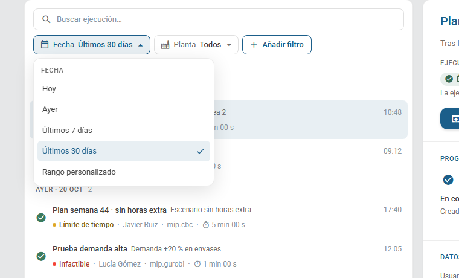
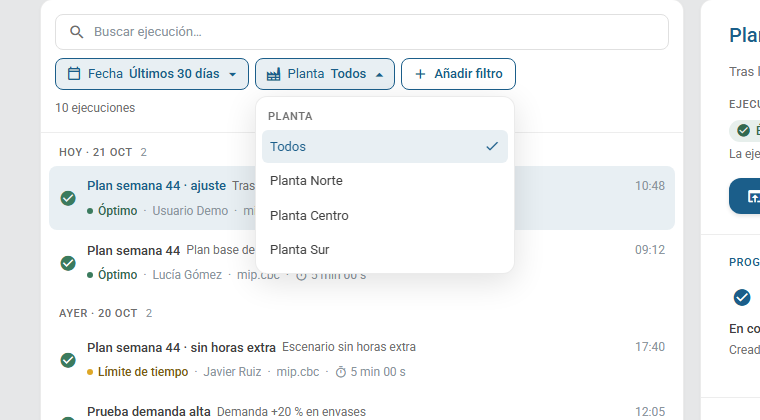
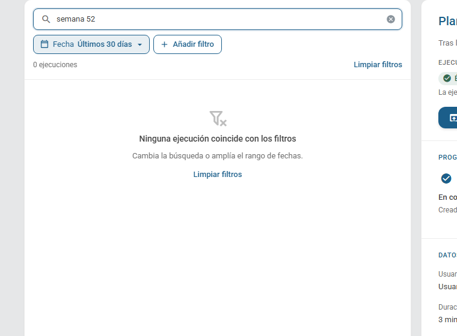
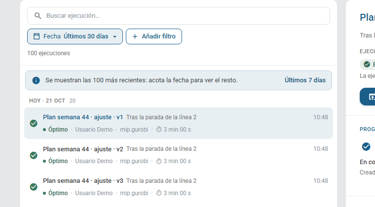

# Filtros del historial

Sobre la lista del historial están la búsqueda y los filtros, para encontrar una ejecución entre muchas: por texto, por fechas, por estado, por usuario o por solver. El proyecto puede añadir filtros propios, como la planta o el programa.

## Cómo se usa

- **Buscar ejecución**: deja las ejecuciones cuyo nombre o descripción contienen el texto.
- **Fecha**: hoy, ayer, últimos 7 días, últimos 30 días (lo que sale al abrir) o un rango propio con **Desde** y **Hasta**.

  

- **Añadir filtro**: un menú con buscador para añadir filtros que se quitan con su aspa. En **Ejecución**: estado de la ejecución, usuario y, si la aplicación replanifica, origen (modelo o replanificación). En **Solución**: estado de la solución y solver. Cada opción dice cuántas ejecuciones deja.
- **Filtros del proyecto** (por ejemplo, **Planta**): salen siempre como un botón más. Ofrecen **Todos** y una opción por cada fila de una tabla de configuración.

  

- **Limpiar filtros** vuelve a cómo se abre el historial.

Si los filtros no dejan ninguna ejecución, la lista lo dice y ofrece limpiarlos:

La lista trae como mucho 100 ejecuciones por rango de fechas. Si llega a 100, avisa de que hay más y propone acotar las fechas:

## Cómo se activa

- **Core.** La búsqueda, la fecha y **Añadir filtro** están siempre.
- **Filtro de origen**: sale con `core.parameters.enableRecalculationOnMasterEdit` (`true` en la plantilla). Solo distingue algo si las ejecuciones de replanificación existen, lo que necesita el módulo `recalculation` de enterprise.
- **Filtros del proyecto**: `core.parameters.executionFilters`, uno por filtro, con:
  - `key`: el parámetro que recibe la lista de ejecuciones;
  - `labelKey`: el texto del botón;
  - `icon` (opcional);
  - `joinFrom`: la tabla y la columna de donde salen las opciones, por ejemplo `'plantas.nombre'`.
- **Backend de los filtros del proyecto**:
  - La tabla de opciones tiene que ser una de las [tablas de configuración](tablas-de-configuracion.md). Sin tablas de configuración, el filtro no sale.
  - El valor elegido solo filtra si la lista de ejecuciones la da un endpoint propio que entienda ese parámetro: `core.parameters.executionsListEndpoint` (por ejemplo, `{ path: '/executions/', isExternal: true }`). La lista de Cornflow ignora los parámetros que no conoce.
  - El backend decide qué filas puede ver cada usuario, tanto en la tabla de opciones como en la lista.
- **Varios módulos**: las opciones son las del módulo activo y se recargan al cambiar de módulo. Cada módulo puede tener sus filtros (ver [Varios DAGs](varios-dags.md)).

## Ver también

- [Historial de ejecuciones](historial-de-ejecuciones.md)
- Referencia técnica: *Execution history filters* del [README](../../README.md#execution-history-filters-optional).
