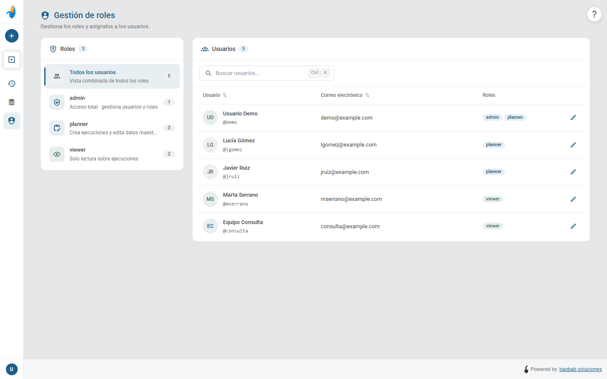
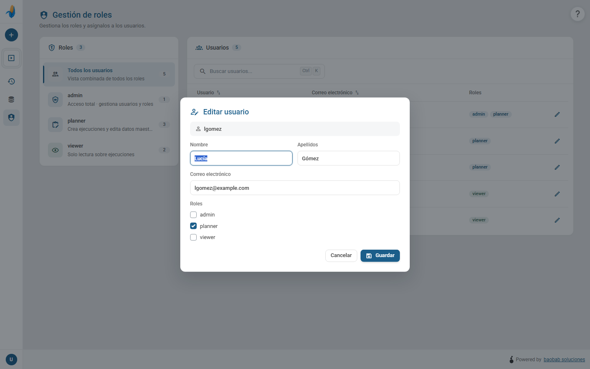
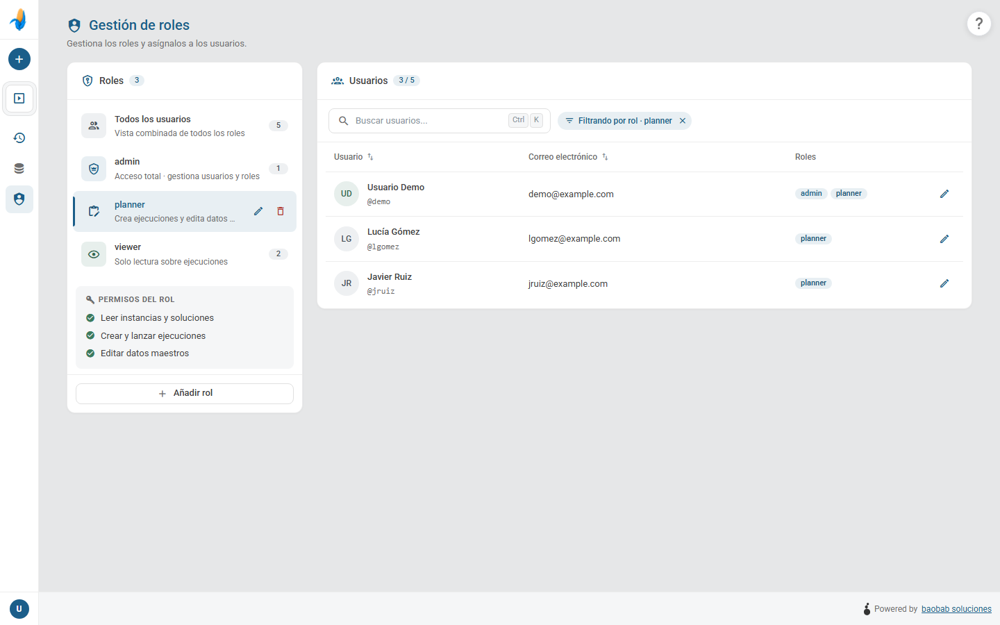

# Gestión de roles

La pantalla donde un administrador ve los roles de la aplicación y decide qué roles tiene cada usuario. Está en **Administración**, en el menú lateral.

## Cómo se usa

- **Roles**, a la izquierda: cada rol con su descripción y cuántos usuarios lo tienen. Al elegir uno, la lista de usuarios se filtra por ese rol y se ven sus permisos. **Todos los usuarios** quita el filtro.
- **Usuarios**, a la derecha: nombre, correo y roles de cada usuario, con un buscador por nombre, correo o rol.
- El lápiz de un usuario abre su ficha: nombre, apellidos, correo y una casilla por rol.

  

- Si la aplicación lo permite, el administrador también crea, renombra y borra roles (**Añadir rol** y los botones del rol elegido). Borrar un rol lo quita a todos sus usuarios.

  

La descripción y la lista de permisos de cada rol son textos de la aplicación para los roles habituales (`admin`, `planner`, `viewer`, `service`). Un rol con otro nombre sale sin descripción. Lo que de verdad puede hacer cada rol lo deciden Cornflow y la configuración del proyecto (ver [Permisos por rol](permisos-por-rol.md)).

## Cómo se activa

- **Core.**
- **Configuración**: `core.parameters.enableRolesManagement` (`true` en la plantilla; si el proyecto quita la clave, la pantalla no sale). Es para toda la aplicación, no por módulo.
- **Crear, renombrar y borrar roles**: `core.parameters.allowEditRoles: true` (por defecto la lista de roles es de solo lectura; asignar roles a usuarios se puede siempre).
- **Roles**: solo la ven los usuarios con el rol `admin` en Cornflow. Para los demás, el grupo **Administración** no sale y la dirección los lleva a su vista de inicio.
- **Backend**: Cornflow (`/roles/`, `/user/`, `/user/role/`). Cornflow decide si el usuario puede hacer cada cambio.

## Ver también

- [Permisos por rol](permisos-por-rol.md)
- [Ajustes de usuario](ajustes-de-usuario.md)
