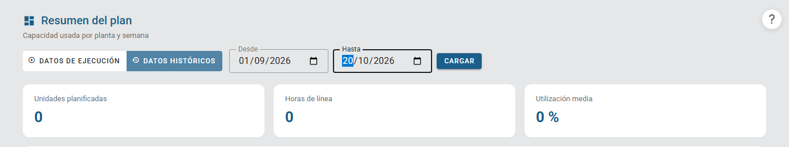
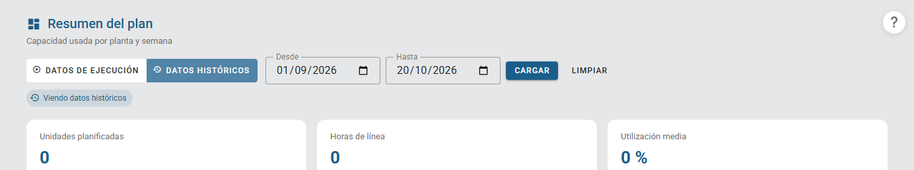

# Histórico en dashboards

Un dashboard a medida puede enseñar, además de los datos de la ejecución cargada, los de un periodo pasado: el usuario elige unas fechas y el backend calcula los indicadores de las ejecuciones de esas fechas.

## Cómo se usa

1. En el dashboard, pasar de **Datos de ejecución** a **Datos históricos**.
2. Elegir **Desde** y **Hasta** y pulsar **Cargar**.
3. La aplicación avisa de cada paso ("Creando ejecución histórica...", "Ejecutando comprobaciones...", "Calculando KPIs...") y, al terminar, el dashboard muestra los datos del periodo.

   

4. Si las comprobaciones encuentran errores, un aviso lo dice y deja ver el detalle. **Limpiar** vuelve a los datos de la ejecución.

## Cómo se activa

- **Core.** El selector lo pone el proyecto en su dashboard a medida; la aplicación no lo muestra por su cuenta.
- **Configuración**: `core.parameters.enableHistoricalKpis` (`true` en la plantilla; si el proyecto quita la clave, el selector no sale).
- **Backend**: necesita un backend propio. La aplicación pide al backend que cree una ejecución con los datos del periodo (`POST /external/historical-kpis/` con las fechas), lanza sus comprobaciones y KPIs en Cornflow y espera a que terminen. Sin ese endpoint no funciona.

## Ver también

- [Dashboards](dashboards.md)
- [KPIs](kpis.md)
