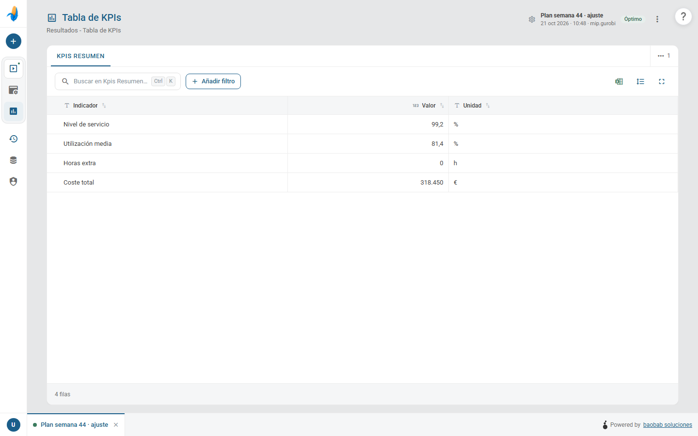

# KPIs

Los indicadores que el backend calcula para una ejecución (nivel de servicio, coste total, utilización…). La aplicación los suma a los resultados: se pueden ver como tablas, en un grupo aparte, y usarlos en los dashboards.

## Cómo se usa

Con los KPIs en un grupo aparte, el grupo **Resultados** del menú tiene **Tabla de KPIs**, entre los datos de la solución y las validaciones. Cada tabla de KPIs es una pestaña y no se edita.

## Cómo se activa

- **Core.**
- **Sumar los KPIs a la solución**: `core.parameters.enableKpisResponseMerge` (`true` en la plantilla; si el proyecto quita la clave, los KPIs se ignoran). Así quedan disponibles para los dashboards del proyecto.
- **Verlos en un grupo aparte**: `core.parameters.kpiTablesDisplayMode: 'separate'` (por defecto `'disabled'`). Necesita la opción anterior. Con `'disabled'`, una tabla de KPIs solo se ve si el esquema de la solución la declara.
- **Backend**: solo hay KPIs si el backend los devuelve junto a la solución, en el campo `kpis` de `GET /execution/<id>/data/` (una tabla por indicador o grupo de indicadores). Sin ese campo, la aplicación no tiene KPIs que enseñar.

## Ver también

- [Resultados](resultados.md)
- [Dashboards](dashboards.md)
- [Histórico en dashboards](historico-en-dashboards.md)
