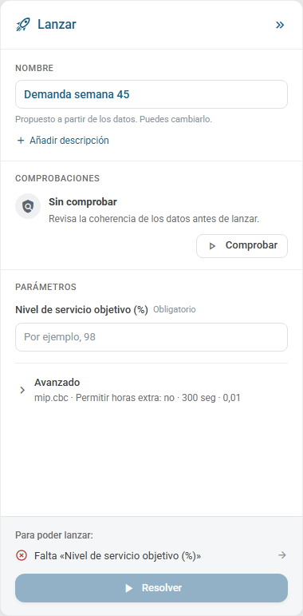
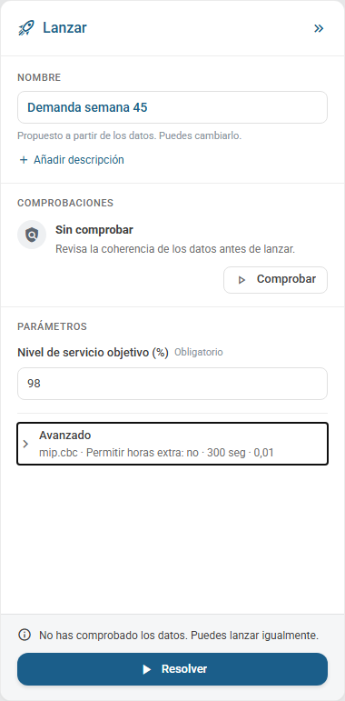
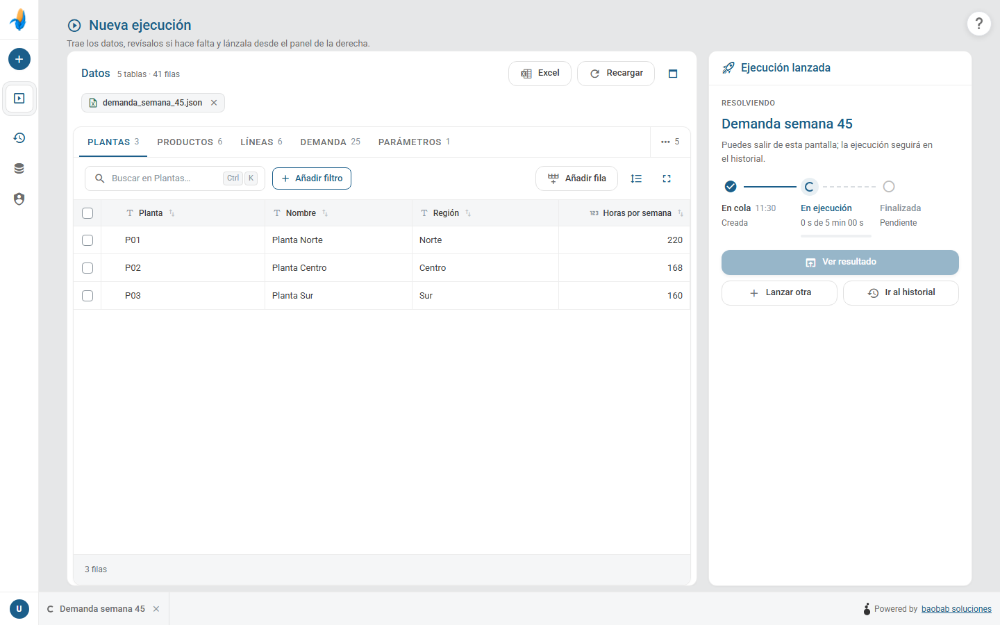

# Lanzar la ejecución

El último paso: darle nombre a la ejecución y resolverla. El panel de la derecha dice qué falta para poder lanzar y, una vez lanzada, sigue la ejecución en directo.

## Cómo se usa

1. **Nombre**: la aplicación propone uno a partir de los datos (el nombre del fichero, o "Datos del" y la fecha). Se puede cambiar; un nombre escrito por el usuario no se vuelve a proponer. **Añadir descripción** añade un texto libre.
2. **Para poder lanzar** lista lo que falta: los datos, corregir errores, un parámetro obligatorio, el nombre… Pulsar una línea lleva a lo que falta.
3. Con todo listo, pulsar **Resolver**. Si hay cambios sin aplicar en las tablas, el botón dice **Aplicar cambios y resolver**. Si no se han comprobado los datos, el panel lo recuerda, pero deja lanzar.

   

4. Lanzada, el panel sigue la ejecución: en cola, resolviendo y terminada, con el tiempo usado. Se puede salir de la pantalla: la ejecución sigue en el historial y en su pestaña.

   

5. **Ver resultado** abre los resultados cuando termina. **Lanzar otra** empieza una ejecución nueva e **Ir al historial** vuelve al historial.

Si el backend rechaza la ejecución, el panel dice "No se ha podido lanzar la ejecución" con el mensaje del servidor.

## Cómo se activa

- **Core.** Siempre está.
- **Nombre propuesto**: `core.parameters.createExecution.proposeName` deja al proyecto su propia regla para proponer el nombre.
- **Backend**: Cornflow. Se guardan los datos (`POST /instance/`, si no se guardaron al comprobarlos), se crea la ejecución (`POST /execution/`) y se sigue su estado (`GET /execution/<id>/`) cada pocos segundos.

## Ver también

- [Parámetros y solver](parametros-y-solver.md)
- [Estados de una ejecución](estados-de-una-ejecucion.md)
- [Resultados](resultados.md)
