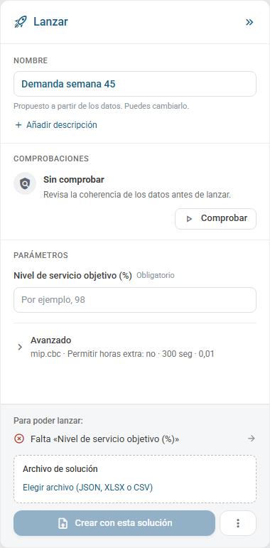
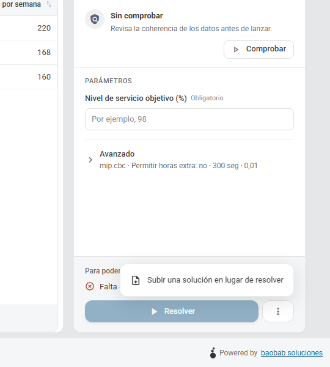

# Modo desarrollador

Una opción para el equipo técnico: crear una ejecución con una solución ya hecha, sin resolver el modelo. Sirve para probar los resultados y los dashboards con una solución conocida.

## Cómo se usa

1. Con los datos cargados, abrir el menú ⋮ (**Más opciones**) del panel de lanzar y elegir **Subir una solución en lugar de resolver**.

   

2. Elegir el fichero de la solución (JSON, Excel o CSV). La aplicación comprueba que cumple el formato de la solución del modelo.
3. Pulsar **Crear con esta solución**. La ejecución se crea sin resolver y con esa solución.

## Cómo se activa

- **Core.**
- **En todos los despliegues de la aplicación**: `core.parameters.isDeveloperMode: true` (apagado por defecto).
- **Solo en un despliegue** (por ejemplo, preproducción): `isDeveloperMode: true` en `values.json` (o `VITE_APP_IS_DEVELOPER_MODE=true`).
- **Backend**: Cornflow (`POST /execution/?run=0` y `PUT /execution/<id>/` con la solución).

## Ver también

- [Lanzar la ejecución](lanzar-ejecucion.md)
- Referencia técnica: *Developer mode* del [README](../../README.md#developer-mode-isdevelopermode).
