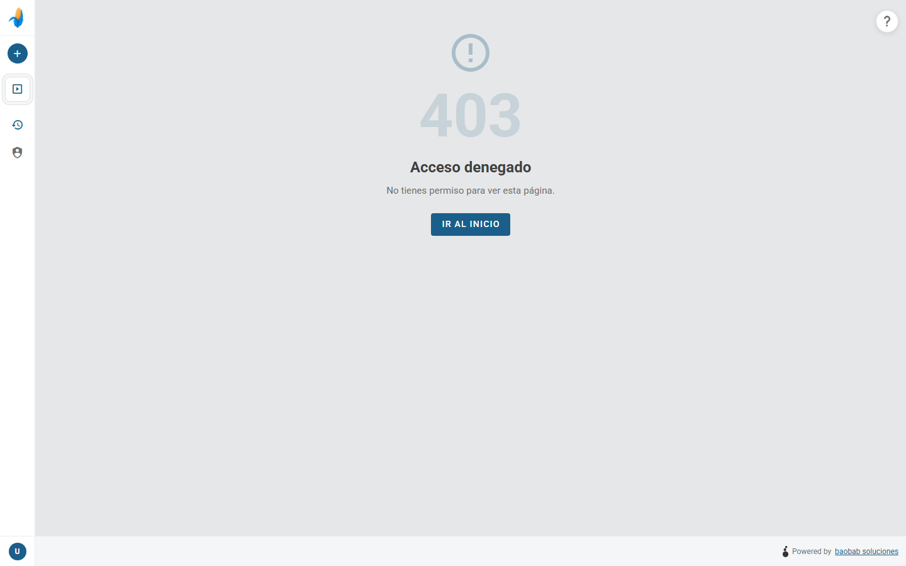

# Página no encontrada y acceso denegado

Lo que ve el usuario cuando abre una dirección que no existe o una vista que su rol no le deja ver. Sale dentro de la aplicación, con el menú lateral, y tiene un botón para volver al inicio.

Si la vista existe pero el usuario no tiene permiso para verla, la página dice **Acceso denegado**:

## Cómo se usa

- **Ir al inicio** lleva a la vista de inicio del usuario.
- Sale **Acceso denegado** cuando:
  - un rol del usuario tiene prohibida esa vista (ver [Permisos por rol](permisos-por-rol.md));
  - la vista es de una sección o dashboard reservado a otros roles o a otro módulo.
- Quien abre **Gestión de roles** sin ser administrador no ve esta página: vuelve a su vista de inicio.

## Cómo se activa

- **Core.** Siempre está.
- **Roles**: lo que cada rol no puede ver se define en `src/app/rolesConfig.ts` del proyecto.

## Ver también

- [Permisos por rol](permisos-por-rol.md)
- [Menú lateral](menu-lateral.md)
