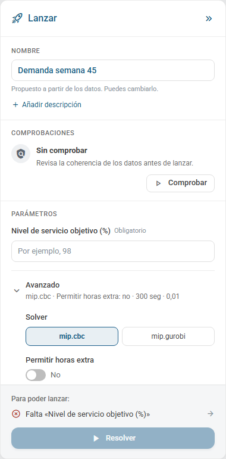

# Parámetros y solver

Los parámetros con los que se resuelve la ejecución (nivel de servicio, tiempo límite, horas extra…) y, si hay varios, el solver. Salen en el panel de lanzar: primero los que hay que decidir, y plegados en **Avanzado** los que ya tienen un valor por defecto.

## Cómo se usa

- Los parámetros **obligatorios** o sin valor por defecto salen arriba, con la etiqueta **Obligatorio** si lo son. Mientras falte uno obligatorio, no se puede lanzar.
- **Avanzado** muestra un resumen de los valores que lleva cada parámetro y se abre para cambiarlos. **Restablecer** vuelve a los valores por defecto.
- Cada parámetro se escribe según su tipo: número, sí o no, fecha, texto, o una lista de opciones (con tres opciones o menos, son botones).
- Un parámetro que toma su valor de los datos cargados lleva la etiqueta **del archivo**. Se puede cambiar igualmente.
- El **solver**, si el modelo tiene más de uno, se elige dentro de **Avanzado**.

Los parámetros con los que se lanzó cada ejecución se ven luego en su detalle del historial.

## Cómo se activa

- **Core.**
- **Qué parámetros hay**: los define el modelo, en el esquema de configuración del DAG. Ahí está su tipo, su valor por defecto, si son obligatorios y las opciones de una lista. Las opciones pueden salir de una tabla de configuración.
- **Su texto**: el nombre de cada parámetro lo pone el proyecto en sus traducciones (`configParams.<parámetro>`). Sin él, sale la clave del parámetro.
- **Valores desde los datos**: `core.parameters.configFields`, con `source` y `param`, dice de qué tabla de los datos sale el valor de un parámetro.
- **Mostrar u ocultar los parámetros**: `core.parameters.configFieldsConfig.showConfigFieldsStep` (sí por defecto). Ocultos, con `autoLoadValues` se toman de los datos o de su valor por defecto.
- **Solver**: las opciones salen del esquema del DAG. `core.parameters.solverConfig.showSolverStep` (sí por defecto) deja elegirlo, y `defaultSolver` es el que se usa si no se pregunta.
- **Backend**: Cornflow, con el esquema del DAG (`GET /schema/<dag>/`).

## Ver también

- [Lanzar la ejecución](lanzar-ejecucion.md)
- Referencia técnica: *Parameters* y *Solver* del [README](../../README.md#solver-solverconfig).
