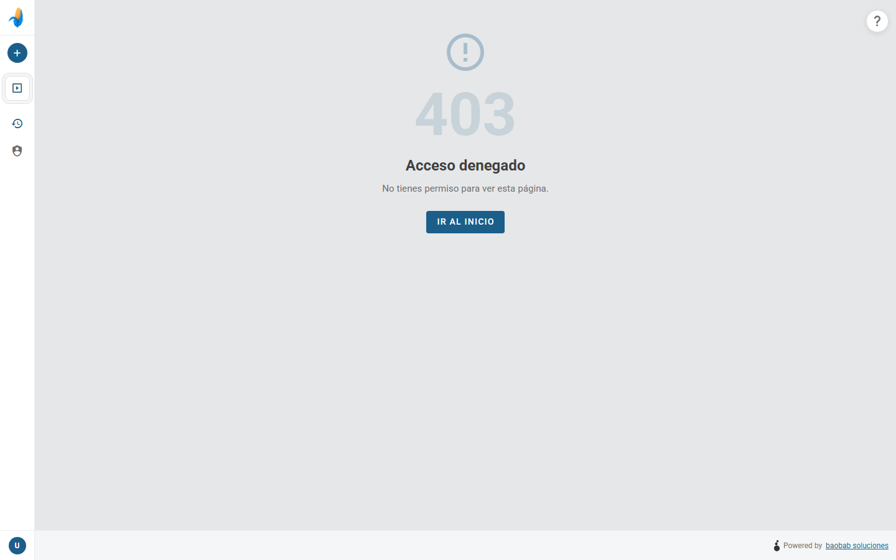

# Permisos por rol

Cada proyecto decide qué vistas no puede abrir cada rol y en qué vista empieza. Una vista prohibida desaparece del menú lateral, y si el usuario llega a ella por su dirección, ve **Acceso denegado**.

## Cómo se usa

Lo configura el proyecto; el usuario solo ve el resultado:

- **Vistas prohibidas**: por ejemplo, un rol de consulta sin **Nueva ejecución** ni tablas de configuración. Las vistas que se pueden prohibir son el historial (`history-execution`), crear ejecución (`project-execution`), las tablas de configuración (`configuration`), los datos de entrada (`input-data`), los resultados (`results`), los dashboards y las secciones propias del proyecto.
- **Vista de inicio por rol**: si la vista de inicio de la aplicación está prohibida para el rol, el usuario empieza en la del rol, o en la primera que pueda ver.
- **Varios roles**: si cualquiera de los roles del usuario prohíbe una vista, no la ve. Un usuario sin roles, o con roles que la configuración no menciona, lo ve todo.
- Además, cada sección propia, dashboard o página de una sección de configuración puede reservarse a unos roles concretos.

## Cómo se activa

- **Core.**
- **Configuración**: `src/app/rolesConfig.ts` del proyecto, por nombre de rol:
  - `forbidden_views`: las vistas que no puede abrir;
  - `defaultView`: su vista de inicio.

  La vista de inicio de la aplicación es `core.parameters.defaultView` (`'history-execution'` por defecto).
- **Secciones y dashboards reservados**: `roles` en cada entrada de `appSections`, `dashboardPages` o `frontendAutomationSectionSubsections`.
- **Backend**: los roles de cada usuario vienen de Cornflow (`GET /user/role/`).
- **Importante**: esto oculta vistas, no protege los datos. Lo que un rol puede hacer de verdad (crear ejecuciones, editar tablas, borrar) lo decide el backend. `rolesConfig.ts` admite también `forbidden_endpoints`, pero la aplicación no lo aplica.

## Ver también

- [Gestión de roles](gestion-de-roles.md)
- [Página no encontrada y acceso denegado](pagina-no-encontrada.md)
- [Menú lateral](menu-lateral.md)
