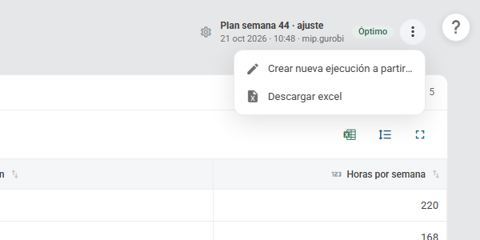
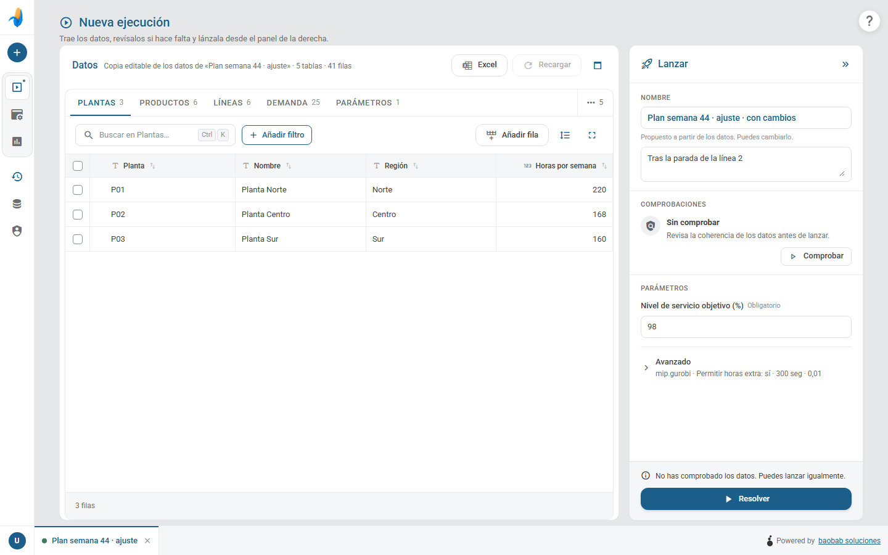

# Relanzar una ejecución

Partir de una ejecución que ya existe para lanzar otra con cambios: se abre la pantalla de nueva ejecución con una copia editable de sus datos, sus parámetros y su descripción. La ejecución original no cambia.

## Cómo se usa

1. Cargar la ejecución y abrir sus [datos de entrada](datos-de-entrada.md).
2. En el menú ⋮ junto al título, elegir **Crear nueva ejecución a partir de los datos de entrada actuales**.
3. La pantalla de nueva ejecución se abre con la copia. Su nombre propuesto es el de la original seguido de "con cambios".

   

4. Cambiar lo que haga falta en las tablas y en los parámetros, y [lanzar](lanzar-ejecucion.md) como cualquier otra.

Al relanzar no se vuelven a traer los datos: los filtros de carga no se piden y **Recargar** está desactivado.

## Cómo se activa

- **Core.**
- **Configuración**: `core.parameters.allowEditInstance` (`true` en la plantilla; si el proyecto quita la clave, la opción no sale).
- **Backend**: Cornflow. Se crea una instancia y una ejecución nuevas.

## Ver también

- [Crear una ejecución](crear-ejecucion.md)
- [Datos de entrada](datos-de-entrada.md)
- Con el módulo `recalculation` de enterprise, las tablas de datos y resultados se pueden editar en su sitio y relanzar desde ahí (ver la documentación de enterprise, *Recálculo de la solución*).
