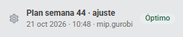
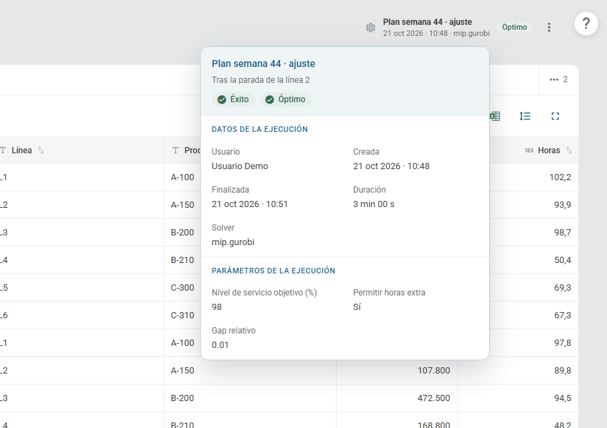

# Resumen de la ejecución

Junto al título de los datos de entrada, los resultados y los dashboards sale un resumen de la ejecución cargada: su nombre, cuándo se creó, con qué solver y su estado. Así el usuario sabe siempre de qué ejecución son los datos que mira.

## Cómo se usa

Al dejar el ratón sobre el nombre se abre el detalle de la ejecución: su descripción, sus estados, quién la lanzó, cuánto duró y con qué parámetros.

## Cómo se activa

- **Core.** Sale siempre que hay una ejecución cargada.
- **Solver**: se oculta con `core.parameters.showExtraProjectExecutionColumns.showSolver: false` (útil si el proyecto solo tiene uno).
- **Contenido a medida**: `core.parameters.executionSummary` deja al proyecto cambiar la línea de debajo del nombre y las etiquetas (por ejemplo, una etiqueta con el tipo de plan).
- Las vistas propias del proyecto pueden ponerlo también junto a su título.

## Ver también

- [Estados de una ejecución](estados-de-una-ejecucion.md)
- [Historial de ejecuciones](historial-de-ejecuciones.md)
