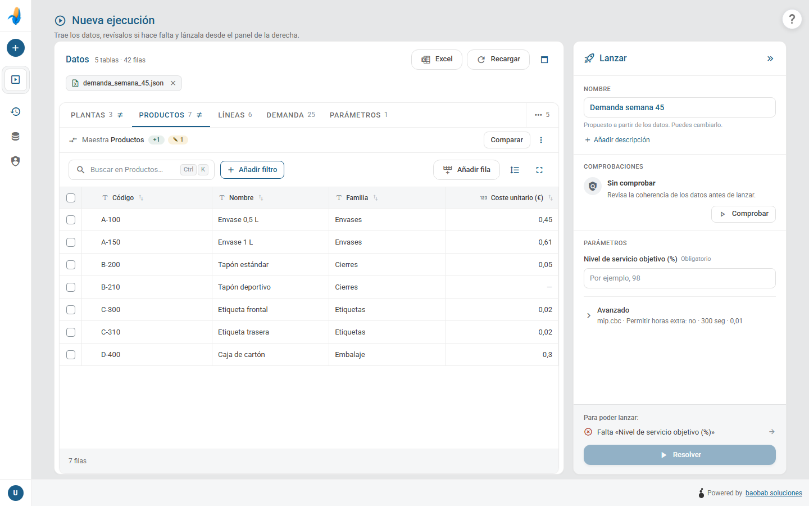
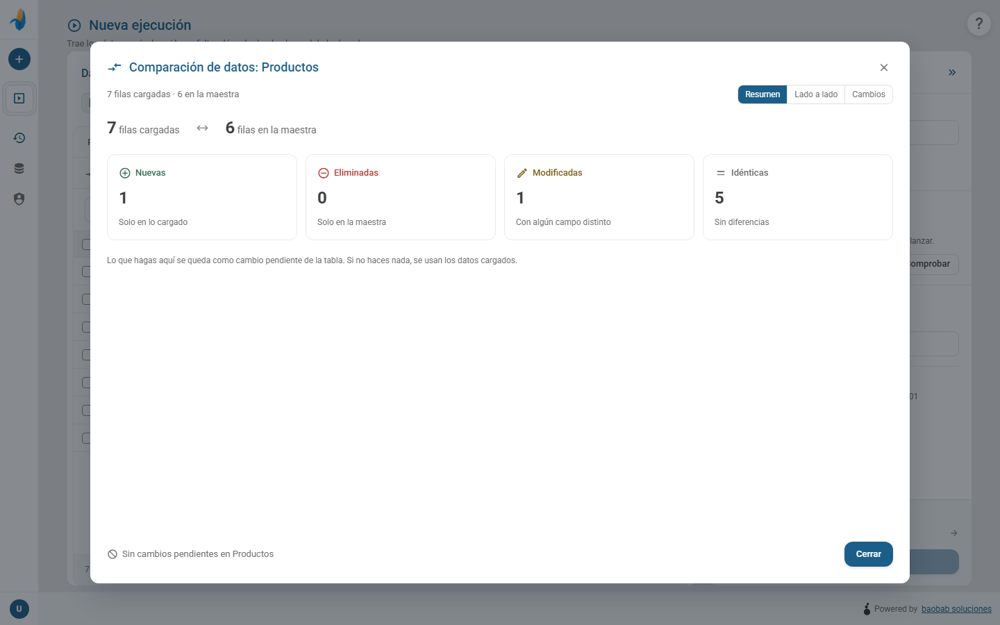
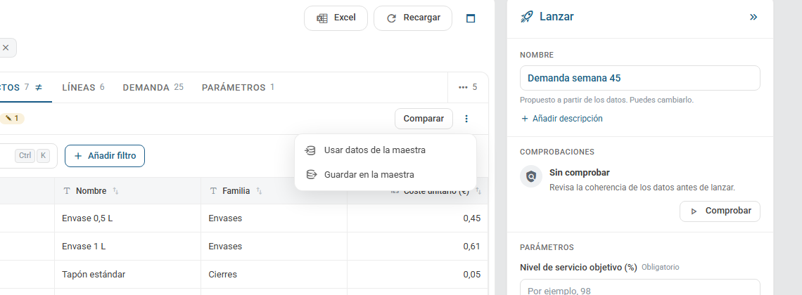

# Sincronización con tablas maestras

Al revisar los datos de una ejecución nueva, la aplicación reconoce las tablas que también son tablas de configuración (tablas maestras) y dice si coinciden. El usuario puede ver las diferencias fila a fila, quedarse con los datos de la maestra o guardar en la maestra los que ha subido.

## Cómo se usa

1. Cargar los datos. La pestaña de una tabla con maestra dice si es idéntica (=) o si tiene diferencias (≠).
2. La barra sobre la tabla nombra la maestra y cuenta las filas que solo están en lo cargado (+), las que solo están en la maestra (−) y las modificadas (✎), o dice **Idénticas**.
3. **Comparar** abre la comparación: un resumen, las dos tablas lado a lado con las celdas que cambian marcadas, y la lista de cambios. Desde ahí se puede quitar una fila de lo cargado o recuperarla de la maestra.

   

4. El menú ⋮ de la barra ofrece **Usar datos de la maestra** (sustituye lo cargado por la maestra) y, si se permite, **Guardar en la maestra** (sobrescribe la maestra con lo cargado). Los dos piden confirmación.

   

## Cómo se activa

- **Core.**
- **Configuración**: `core.parameters.enableMasterTableMatching: true` (en la plantilla viene a `false`).
- **Guardar en la maestra**: además, `core.parameters.enableReplaceMasterWithUploaded: true` (apagado por defecto), y que la tabla de configuración permita sobrescribirla entera (`overwrite_all` en el backend). Si el backend avisa de que hay datos que dependen de ella, la aplicación pide confirmar antes de forzarlo.
- **Qué tablas se emparejan**: las que se llaman igual en los datos y en las tablas de configuración, sin importar mayúsculas, guiones o guiones bajos. El backend puede dar otro nombre con `model_table_name`.
- **Cómo se comparan las filas**: por defecto, fila a fila. `core.parameters.masterTableMatchingConfig` dice, por tabla, qué columnas identifican una fila (por ejemplo, el código de producto).
- **Backend**: necesita [tablas de configuración](tablas-de-configuracion.md) (frontend automation).

## Ver también

- [Crear una ejecución](crear-ejecucion.md)
- [Tablas de configuración](tablas-de-configuracion.md)
- Referencia técnica: *Master table matching* del [README](../../README.md#master-table-matching-instance-synchronization).
