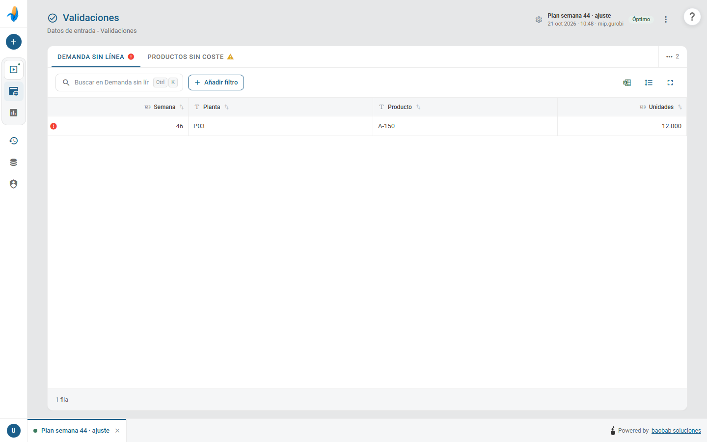

# Validaciones

Las comprobaciones que el modelo hizo sobre los datos y la solución de una ejecución: qué filas tienen un problema y si es un error o un aviso. Están en **Validaciones**, dentro de los datos de entrada y de los resultados.

## Cómo se usa

- Cada comprobación es una pestaña con las filas que encontró. Solo salen las que encontraron algo.
- La pestaña y cada fila llevan un icono: rojo si es un error, amarillo si es un aviso.
- **Descargar excel**, en el menú ⋮, baja todas las validaciones en un fichero.

## Cómo se activa

- **Core.** Salen cuando el modelo define comprobaciones (`instance_checks` para los datos, `solution_checks` para la solución) y alguna encuentra filas.
- **Error o aviso**: lo dice cada comprobación en el esquema (`is_warning: true` para un aviso). Si no lo dice, es un error.
- **Backend**: Cornflow y el DAG, que calcula las comprobaciones.

## Ver también

- [Comprobaciones de datos](comprobaciones-de-datos.md): las mismas comprobaciones, antes de lanzar.
- [Datos de entrada](datos-de-entrada.md)
- [Resultados](resultados.md)
