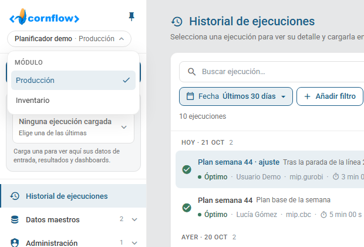
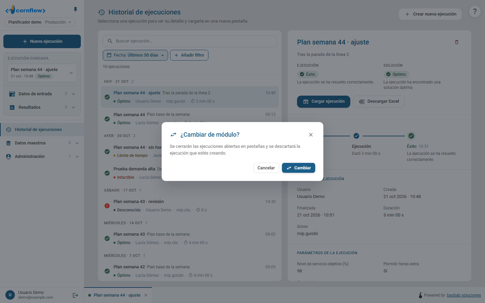
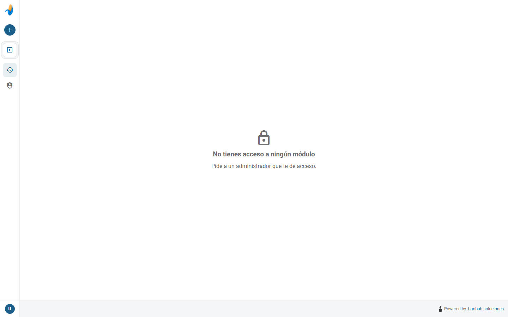

# Varios modelos en una aplicación (varios DAGs)

Una misma aplicación puede servir varios modelos de optimización (en Cornflow, varios DAGs), por ejemplo uno de producción y otro de inventario. En la aplicación cada uno es un **módulo**: el usuario elige con cuál trabaja y la aplicación le enseña los datos, las tablas y las ejecuciones de ese módulo.

Con el menú plegado, el icono de la aplicación lleva la inicial del módulo activo. Desplegado, el módulo sale junto al nombre de la aplicación; para quien puede cambiar de módulo, esa línea es un selector:

## Cómo se usa

1. Pulsar el nombre del módulo bajo el logo y elegir otro.
2. Si hay ejecuciones abiertas en pestañas, o una ejecución a medio crear, la aplicación pide confirmación, porque se cerrarán:

   

3. Al cambiar, la aplicación carga el modelo del nuevo módulo, sus tablas y sus filtros. El usuario sigue en la misma vista si el nuevo módulo la tiene, y va a su vista de inicio si no.

Cada usuario entra en los módulos que Cornflow le da:

| Módulos del usuario | Lo que ve |
| --- | --- |
| Uno | La aplicación en ese módulo, sin selector |
| Varios | El selector. Empieza en el último que eligió en la sesión, o en el primero de la configuración |
| Ninguno | Un mensaje: "No tienes acceso a ningún módulo" |

## Cómo se activa

- **Core.** Apagado salvo que se configure: con un solo modelo la aplicación se ve igual que siempre.
- **Configuración del despliegue**: `schema` en `values.json` (o `VITE_APP_SCHEMA`) con los nombres de los DAGs separados por comas. El primero es el de entrada.
- **Nombres en el selector**: `core.parameters.schemaLabels` (por ejemplo, `{ planificacion_dag: 'Producción' }`). Sin él, sale el nombre del DAG.
- **Ajustes por módulo**: `core.schemaOverrides` da a cada módulo sus propios parámetros cuando no funcionan igual (por ejemplo, uno carga los datos desde base de datos y otro no, o tienen dashboards distintos). Hay ajustes que son de toda la aplicación y no cambian por módulo: el tema oscuro, la gestión de roles o los nombres del selector.
- **Qué ve cada módulo**: las tablas de configuración, las secciones propias y los dashboards pueden reservarse a unos módulos.
- **Backend**: Cornflow dice qué módulos tiene cada usuario (`GET /schema/`), según los permisos de DAG de cada usuario. Solo los distingue si el despliegue de Cornflow está cerrado (`OPEN_DEPLOYMENT=0`); si no, todos los usuarios ven todos los módulos. El backend de la aplicación recibe el módulo activo en cada lista de tablas y de ejecuciones, y puede devolver solo lo de ese módulo.

## Ver también

- [Menú lateral](menu-lateral.md)
- [Tablas de configuración](tablas-de-configuracion.md)
- Referencia técnica: *Several DAGs* del [README](../../README.md#several-dags-optional) y [qué recibe el backend](../backend-several-dags.md) (en inglés).
