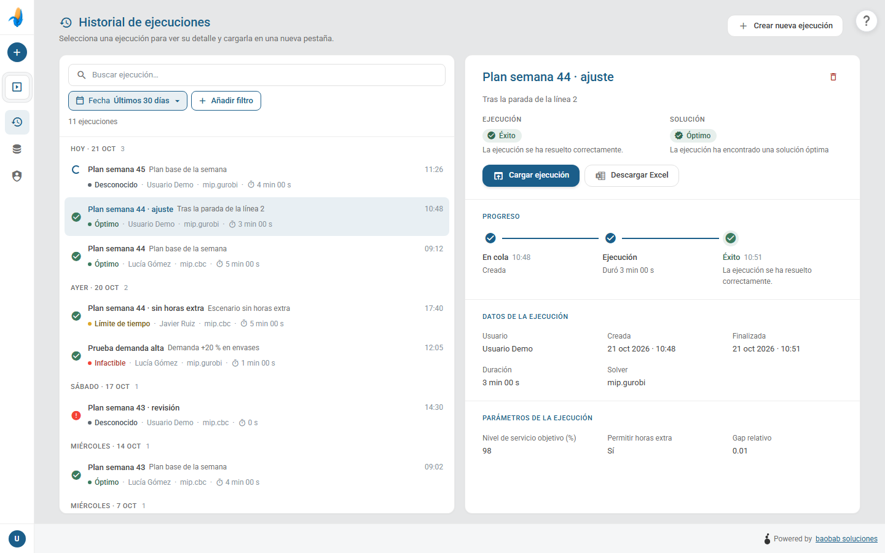
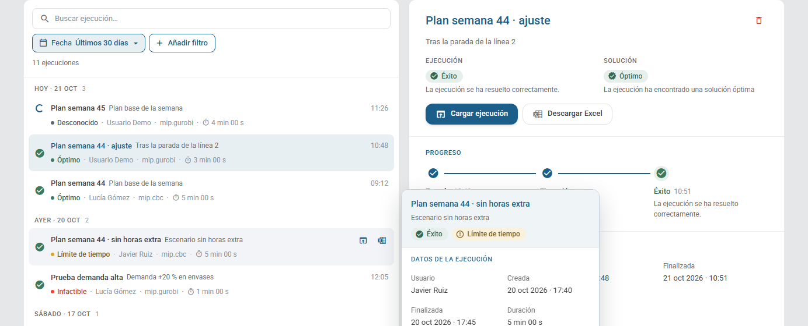
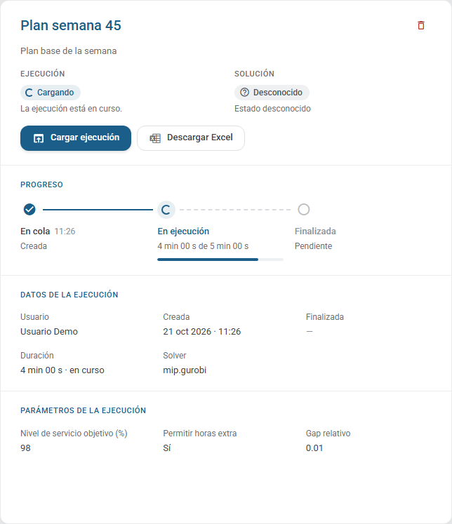
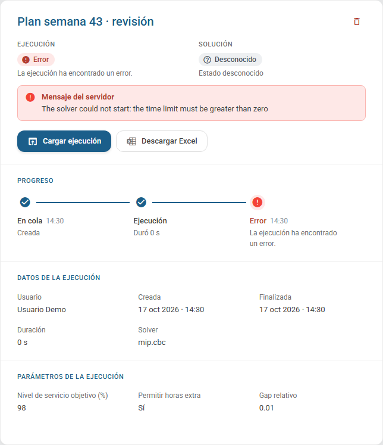
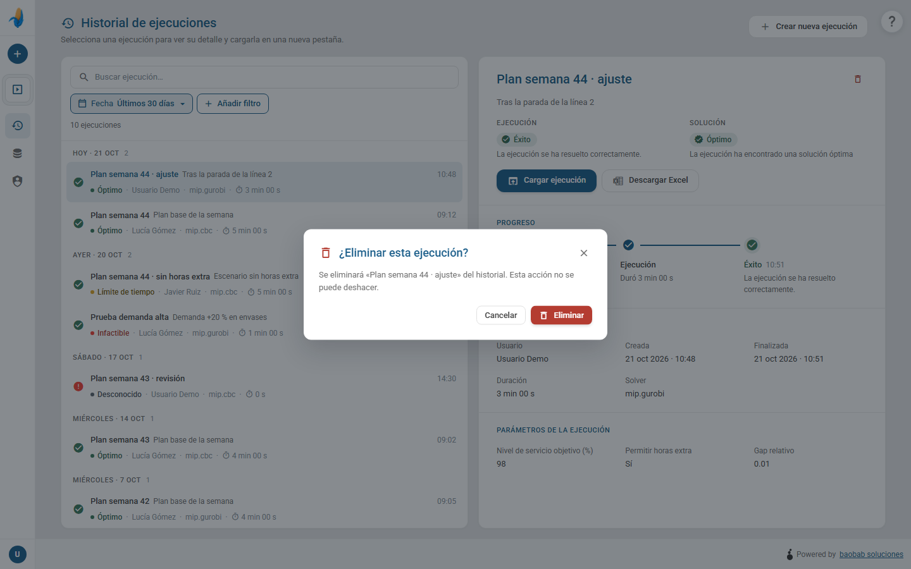
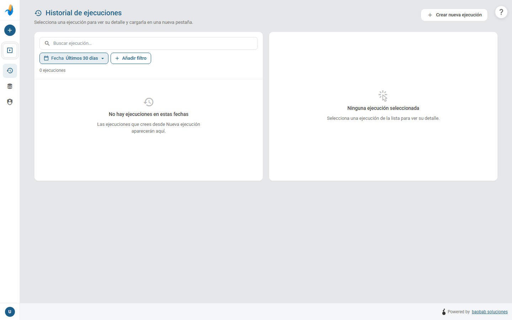

# Historial de ejecuciones

La lista de todas las ejecuciones lanzadas, agrupadas por día, con el detalle de la que se selecciona al lado. Desde aquí se abre una ejecución para ver sus datos, se descarga a Excel o se borra. Es la vista de inicio por defecto.

## Cómo se usa

**La lista.** Cada fila dice el estado de la ejecución, su nombre, su descripción y la hora; debajo, el estado de la solución, quién la lanzó, el solver y cuánto duró. Al pasar el ratón por una fila salen **Cargar** y **Excel**, y una ficha con el resumen de la ejecución:

Arriba están la búsqueda y los filtros (ver [Filtros del historial](filtros-del-historial.md)).

**El detalle** de la ejecución seleccionada tiene:

- El nombre, la descripción y el botón de borrar.
- El estado de la ejecución y el de la solución, cada uno con su explicación (ver [Estados de una ejecución](estados-de-una-ejecucion.md)). Si la ejecución falló, el mensaje del servidor.
- **Cargar ejecución** abre la ejecución en una pestaña y la deja seleccionada: sus [datos de entrada](datos-de-entrada.md) y sus [resultados](resultados.md) aparecen en el menú lateral.
- **Descargar Excel** baja los datos de entrada y la solución.
- **Progreso**: en cola, en ejecución (con el tiempo usado de su límite) y cómo terminó.
- **Datos de la ejecución**: usuario, creación, fin, duración y solver.
- **Parámetros de la ejecución**: los valores con los que se lanzó.

Una ejecución en curso se va actualizando sola:

Una ejecución que falló muestra el mensaje del servidor:

**Borrar** pide confirmación y no se puede deshacer:

Sin ejecuciones en las fechas elegidas, la lista lo dice:

**Crear nueva ejecución**, arriba a la derecha, lleva a [crear una ejecución](crear-ejecucion.md).

En pantallas estrechas la lista ocupa todo el ancho y, al elegir una ejecución, el detalle la sustituye con un botón para volver.

## Cómo se activa

- **Core.** Siempre está.
- **Qué datos se ven** de cada ejecución: `core.parameters.showExtraProjectExecutionColumns`.
  - `showUserFullName` (sí en la plantilla) o `showUserName`: quién la lanzó, por nombre completo o por usuario.
  - `showEndCreationDate` (sí): cuándo terminó.
  - `showSolver` (sí; se quita con `false`): el solver.
  - `showTimeLimit` (no): el tiempo límite.
- **Nombres y colores de los estados**: `core.parameters.executionStates` y `solutionStates`.
- **Descarga**: con `core.parameters.useBackendExecutionFilesDownload: true`, el Excel lo genera el backend (`GET /execution/files/<id>/`) en lugar del navegador. Necesita un backend que lo implemente.
- **Roles**: se oculta a los roles que tengan prohibida la vista `history-execution`. Quién puede borrar lo decide Cornflow.
- **Backend**: Cornflow (`GET /execution/`, `GET /execution/<id>/data/`, `DELETE /execution/<id>/`), o el endpoint propio de `executionsListEndpoint` para la lista.
- Con el módulo `latest-plan` de enterprise, el detalle tiene además **Establecer como plan actual** y la etiqueta **Actual**.

## Ver también

- [Filtros del historial](filtros-del-historial.md)
- [Estados de una ejecución](estados-de-una-ejecucion.md)
- [Barra de pestañas](barra-de-pestanas.md)
- Referencia técnica: *Execution history* del [README](../README.md#execution-history).
