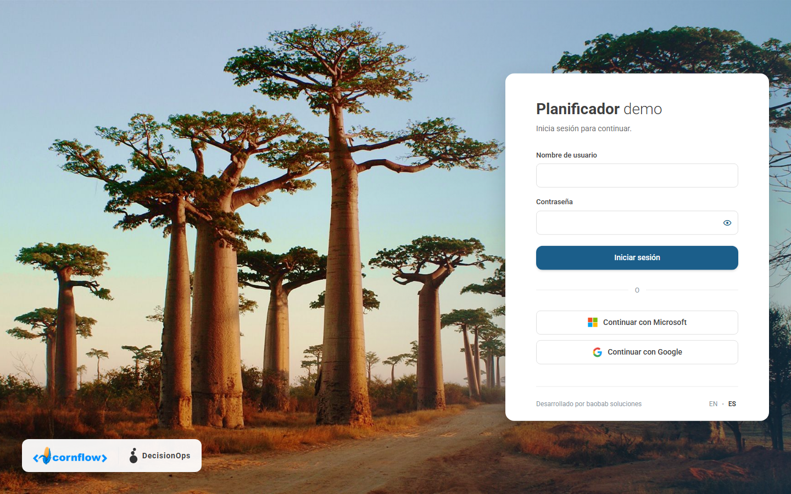
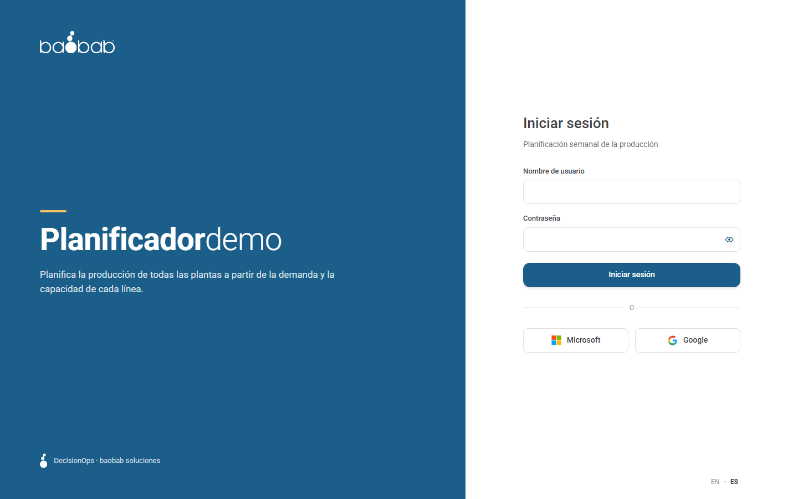
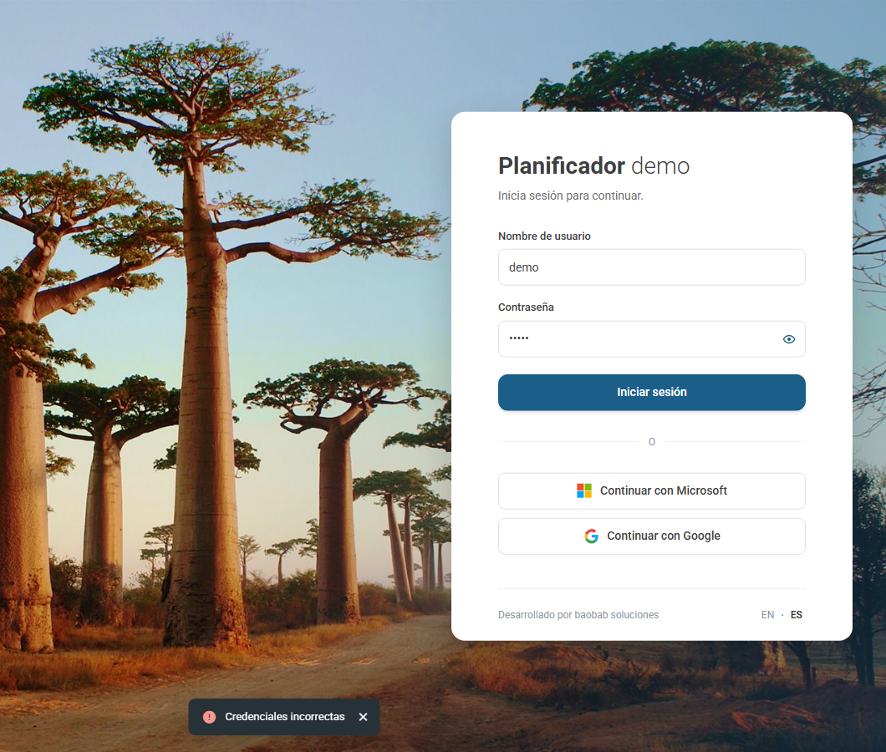
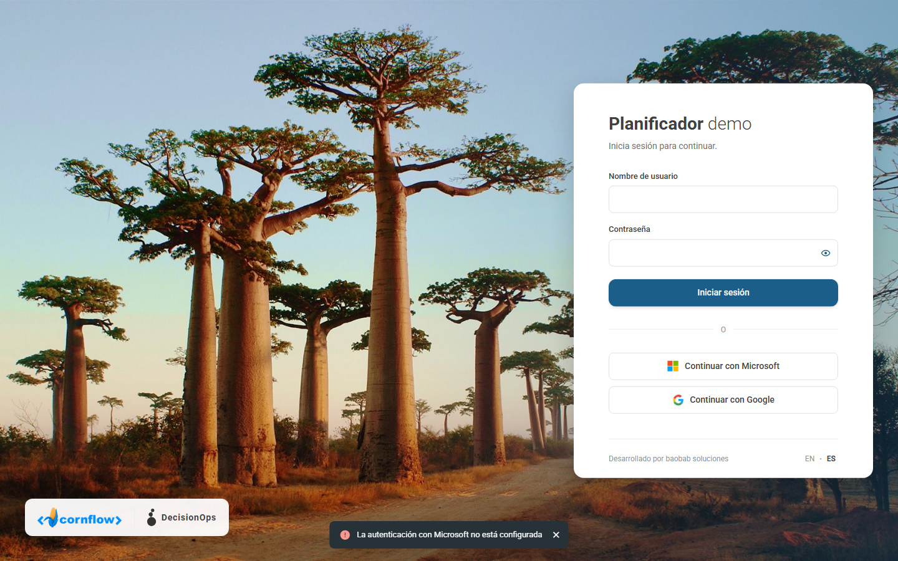

# Inicio de sesión

La puerta de entrada a la aplicación. El usuario entra con su usuario y contraseña de Cornflow, o con su cuenta de Microsoft o de Google si el despliegue lo tiene configurado.

La pantalla tiene dos diseños. El de foto (arriba) es el que sale por defecto. El de marca pone un panel con el color de la aplicación, el logo de la empresa y una frase que describe la herramienta:

## Cómo se usa

1. Escribir el nombre de usuario y la contraseña y pulsar **Iniciar sesión**. El ojo de la contraseña la muestra u oculta.
2. Con un usuario o contraseña que no valen, un aviso dice **Credenciales incorrectas**. Si el servidor no responde, dice **Error del servidor**. Un campo vacío se marca como **Requerido**.

   

3. **Continuar con Microsoft** y **Continuar con Google** llevan al inicio de sesión de esa cuenta. Los dos botones salen siempre. Si el despliegue no tiene ese proveedor configurado, al pulsarlo un aviso lo dice: "La autenticación con Microsoft no está configurada".

   

4. Abajo a la derecha se elige el idioma (por ejemplo, EN · ES). Solo sale si la aplicación ofrece más de uno.

Al entrar, la aplicación muestra "Cargando..." mientras trae el usuario y la configuración, y abre la vista de inicio (el historial de ejecuciones, salvo que el proyecto elija otra).

**Al cerrar la sesión.** El botón de salir está al pie del menú lateral, junto al usuario, y pide confirmación. La sesión dura lo que la pestaña del navegador: una pestaña nueva pide entrar otra vez.

**Si la sesión caduca.** Cuando el servidor da la sesión por terminada, la aplicación vuelve a la pantalla de inicio de sesión sin más aviso. Con Microsoft o Google, la sesión se renueva sola antes de caducar.

No hay registro de usuarios ni recuperación de contraseña desde la aplicación: los usuarios los da de alta un administrador en Cornflow.

## Cómo se activa

- **Core.** Siempre está.
- **Diseño**: `core.parameters.login.layout`, `'photo'` (por defecto) o `'brand'`. Con `'brand'`, `login.description` es la frase del panel. `login.subtitle` cambia el texto bajo el título ("Inicia sesión para continuar." por defecto). El título es el nombre de la aplicación (`name` en `values.json`).
- **Imágenes**: la foto de fondo (`login_background.png`), el logo (`full_logo.png`) y el logo de empresa del diseño de marca (`company_logo.png`) están en `src/app/assets` del proyecto.
- **Tipo de acceso**: `auth_type` en `values.json` (o `VITE_APP_AUTH_TYPE`): `cornflow` (por defecto), `azure` o `cognito`.
  - Microsoft funciona con `azure`, o con `cognito` si `microsoft` está entre sus proveedores.
  - Google funciona solo con `cognito` y `google` entre sus proveedores.
  - Cada uno necesita sus datos de conexión (cliente, autoridad o *user pool*, dominio…), que se piden al equipo de sistemas.
- **Idiomas del selector**: `languages` en `src/app/config.ts`.
- **Backend**: Cornflow (`POST /login/`). Con Microsoft o Google, Cornflow tiene que aceptar sus tokens.

## Ver también

- [Ajustes de usuario](ajustes-de-usuario.md): cambiar la contraseña y el idioma.
- [Gestión de roles](gestion-de-roles.md).
- Referencia de configuración: sección *Authentication* del [README](../README.md#authentication).
