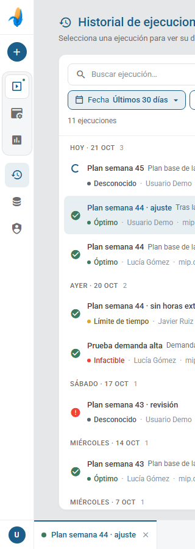
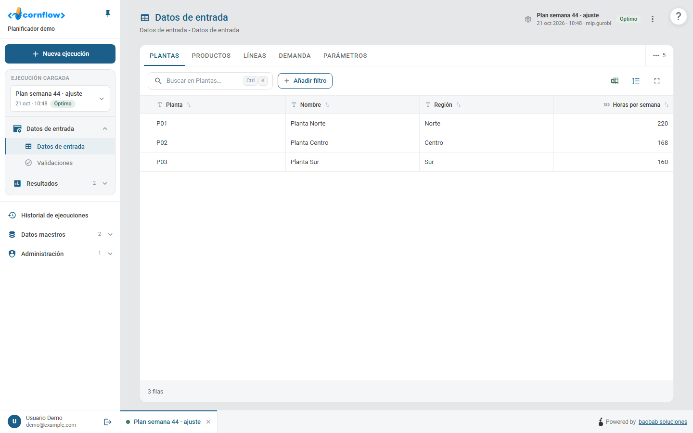
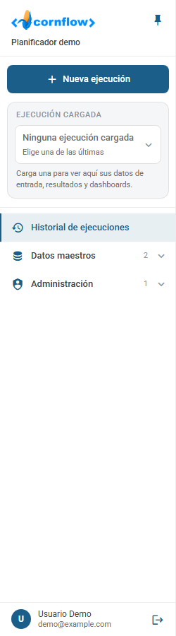
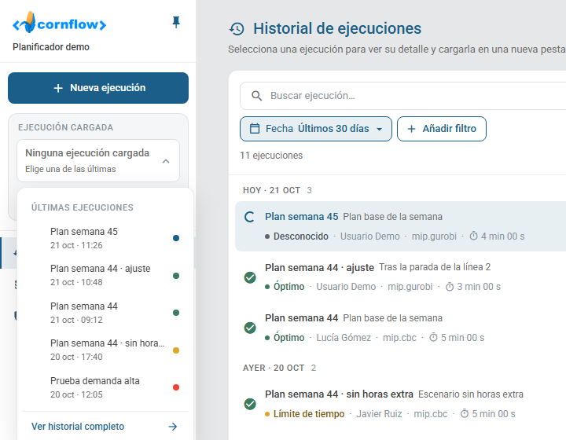

# Menú lateral

El menú de la izquierda lleva a todas las partes de la aplicación. Separa lo que es de la ejecución cargada (sus datos de entrada, sus resultados y sus dashboards) de lo que es igual para todas (el historial, las tablas de configuración, la administración).

Está plegado por defecto: una columna de iconos. Al pasar el ratón por encima se despliega sobre el contenido y se vuelve a plegar al salir.

Fijado con la chincheta, el menú queda abierto y el contenido se aparta:

## Cómo se usa

De arriba abajo, el menú desplegado tiene:

- **El logo y la chincheta**, que fija el menú o lo deja plegarse. Debajo, el nombre de la aplicación (y el módulo activo, si la aplicación tiene varios; ver [Varios DAGs](varios-dags.md)).
- **Nueva ejecución**, que abre la pantalla para [crear una ejecución](crear-ejecucion.md).
- **Ejecución cargada**: el nombre, la fecha y el estado de la ejecución con la que se está trabajando. Debajo, sus grupos: **Datos de entrada** y **Resultados** (con sus dashboards). Sin ninguna cargada, el bloque lo dice:

  

  Al pulsar la ejecución se abren las cinco más recientes, para cambiar de una a otra sin pasar por el historial, y **Ver historial completo**:

  

- **Los grupos comunes**, en este orden: el **Historial de ejecuciones**, las secciones propias del proyecto, las tablas de configuración (un grupo por cada sección que defina el backend, o uno solo, **Tablas de configuración**) y **Administración**, que solo ven los administradores.
- **El usuario**, al pie: lleva a sus [ajustes](ajustes-de-usuario.md). Al lado, el botón para cerrar la sesión, que pide confirmación.

Los grupos se abren de uno en uno. Un grupo cerrado dice cuántas páginas tiene y marca con un punto el que contiene la página en pantalla. Un grupo de tablas es una sola página: sus tablas son las pestañas de esa página.

En pantallas estrechas (768 px o menos), el menú fijado se pone encima del contenido y se cierra con la X.

## Cómo se activa

- **Core.** Siempre está.
- **Qué grupos ve cada usuario**: los que su rol le deja ver (ver [Permisos por rol](permisos-por-rol.md)). **Nueva ejecución** no sale a quien tiene prohibido crear ejecuciones.
- **Nombre del usuario**: con `core.parameters.showOpenIdUsername` (`true` en la plantilla) sale su nombre completo; sin él, su nombre de usuario.
- **Títulos de los grupos**: `core.parameters.sectionTitles` cambia "Tablas de configuración", "Datos de entrada" y "Resultados" por los textos del proyecto.
- **Secciones propias**: el proyecto añade las suyas con `appSections` en `src/app/config.ts` (por ejemplo, una vista a medida). Cada una puede reservarse a unos roles o a unos módulos, o salir solo con una ejecución cargada.
- **Logos**: `logo.png` (menú plegado) y `full_logo.png` (desplegado), en `src/app/assets/logo` del proyecto.
- **Backend**: las cinco últimas ejecuciones salen de la lista de ejecuciones de Cornflow (`GET /execution/`).

## Ver también

- [Barra de pestañas](barra-de-pestanas.md)
- [Historial de ejecuciones](historial-de-ejecuciones.md)
- [Tablas de configuración](tablas-de-configuracion.md)
- Referencia técnica: sección *Side menu* del [README](../README.md#side-menu).
