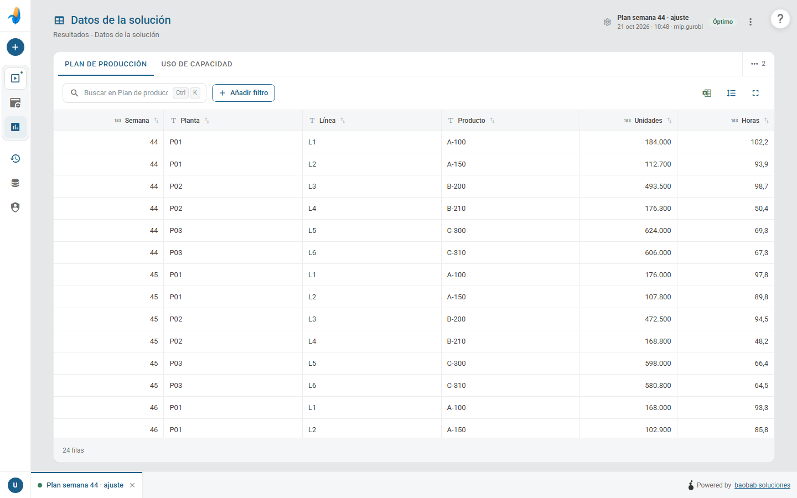

# Resultados

La solución de la ejecución cargada: las tablas que devuelve el modelo (el plan, el uso de la capacidad…), sus validaciones, sus KPIs y los dashboards del proyecto. Aparecen en el menú lateral, dentro de la ejecución cargada.

## Cómo se usa

En el grupo **Resultados** del menú lateral:

- **Datos de la solución**: una pestaña por tabla de la solución, con búsqueda, filtros, descarga a Excel y pantalla completa (ver [Tablas de datos](tablas-de-datos.md)).
- **Tabla de KPIs**, si el proyecto muestra los KPIs aparte (ver [KPIs](kpis.md)).
- **Validaciones**: las comprobaciones de la solución que encontraron algo (ver [Validaciones](validaciones.md)).
- Los dashboards del proyecto (ver [Dashboards](dashboards.md)).

El menú ⋮ junto al título tiene **Descargar excel**, que baja todas las tablas de la solución en un fichero.

## Cómo se activa

- **Core.** Sale en cuanto hay una ejecución cargada.
- **Qué tablas salen**: las del esquema de solución del modelo, con las mismas reglas que los [datos de entrada](datos-de-entrada.md) (`visible: false`, `showTablesWithoutSchema`).
- **Título del grupo**: `core.parameters.sectionTitles.results`.
- **Roles**: se oculta a los roles que tengan prohibida la vista `results`.
- **Backend**: Cornflow (`GET /execution/<id>/data/`).

## Ver también

- [Datos de entrada](datos-de-entrada.md)
- [KPIs](kpis.md)
- [Dashboards](dashboards.md)
- Referencia técnica: *Results section* del [README](../README.md#results-section).
