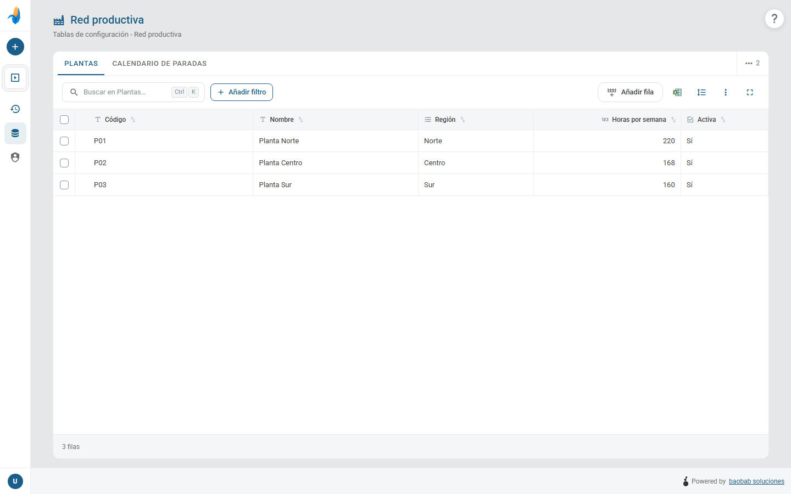
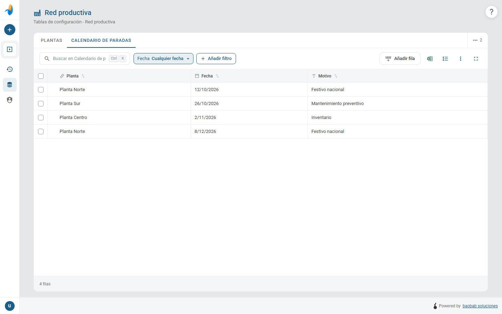
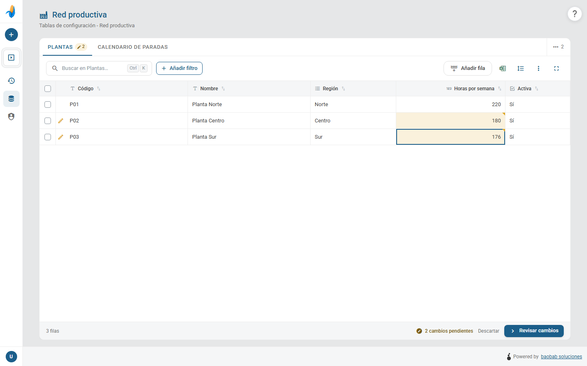
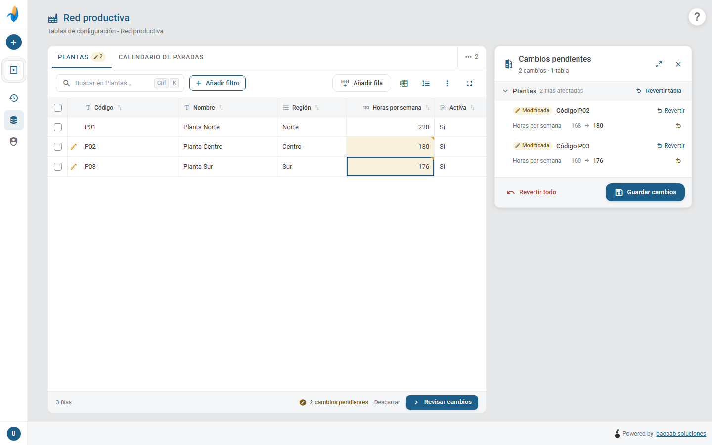
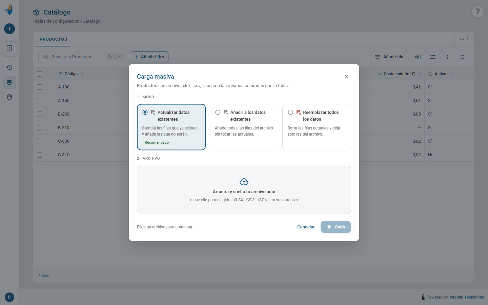

# Tablas de configuración

Los datos maestros del cliente (plantas, productos, calendarios…) que el usuario mantiene desde la aplicación. Las genera la aplicación sola a partir de lo que describe el backend: qué tablas hay, cómo se agrupan, qué columnas tienen y qué se puede hacer con cada una.

## Cómo se usa

**Dónde están.** En el menú lateral, un grupo por cada sección que defina el backend (por ejemplo, **Datos maestros**), o uno solo, **Tablas de configuración**. Dentro, cada grupo de tablas es una página con una pestaña por tabla.

**Consultar.** Búsqueda, filtros por columna, orden, descarga a Excel y pantalla completa, como en todas las [tablas de datos](tablas-de-datos.md). Si el backend lo prevé, la tabla tiene además un filtro de **Fecha** con desde y hasta:

Una columna que apunta a otra tabla (por ejemplo, la planta de una parada) muestra el nombre, no el identificador, y al editarla ofrece las filas de esa tabla.

**Editar.** Celda a celda, como en una hoja de cálculo, con **Añadir fila**, **Edición masiva** y **Eliminar**. Los cambios quedan pendientes, marcados en la tabla:

**Revisar cambios** abre la lista de cambios pendientes, agrupados por tabla. Cada uno se puede deshacer; **Guardar cambios** los manda todos al backend y **Revertir todo** los descarta. Si el backend rechaza algo, el panel muestra su mensaje.

Al salir de las tablas con cambios sin guardar, la aplicación pide confirmación.

**Carga masiva.** En el menú ⋮ de la tabla, **Carga masiva** sube un Excel, CSV o JSON de una vez, sin pasar por los cambios pendientes. Hay tres modos: **Actualizar datos existentes** (el recomendado), **Añadir a los datos existentes** y **Reemplazar todos los datos**.

Para cargar todas las tablas de una vez, ver [Cargar todas las tablas maestras](cargar-todas-las-tablas-maestras.md).

## Cómo se activa

- **Core.** Salen cuando el backend describe sus tablas (frontend automation). Sin ese backend no hay tablas de configuración.
- **Backend**: necesita un backend propio que dé `GET /external/frontend-automation/`, con las tablas, sus grupos y secciones, sus columnas y, por cada tabla, los endpoints de lo que se puede hacer con ella. La aplicación enseña solo lo que el backend permite:

  | Lo que ve el usuario | Lo que tiene que dar el backend para esa tabla |
  | --- | --- |
  | La tabla | Su lista (`get_list`) |
  | Editar celdas, marcar filas, edición masiva | Modificar una fila (`put_item`) |
  | **Añadir fila** | Además, crear una fila (`post_item`) |
  | **Eliminar** | Además, borrar filas (`delete_item` o `delete_bulk`) |
  | **Carga masiva** y sus modos | Cargas en bloque (`post_update_bulk`, `post_bulk`, `overwrite_all`). Para ficheros muy grandes, sus versiones que trabajan en segundo plano |
  | Excel generado por el backend | `download_excel_table`. Sin él, la aplicación genera el Excel con las filas cargadas |
  | Filtro de **Fecha** | Un filtro de fecha desde y hasta en la lista |

- **Roles**: los grupos de configuración se ocultan a los roles que tengan prohibida la vista `configuration`. Dentro de una tabla, lo que se puede hacer no depende del rol: lo decide el backend.
- **Varios módulos**: cada tabla puede reservarse a unos módulos (`schemas` en la descripción del backend), y el backend recibe el módulo activo en cada lista.
- **Títulos**: `core.parameters.sectionTitles.masterData` cambia "Tablas de configuración".
- **Páginas propias dentro de una sección** (por ejemplo, un dashboard de los datos maestros): `frontendAutomationSectionSubsections` en `src/app/config.ts`.

## Ver también

- [Tablas de datos](tablas-de-datos.md)
- [Cargar todas las tablas maestras](cargar-todas-las-tablas-maestras.md)
- [Sincronización con tablas maestras](sincronizacion-con-tablas-maestras.md)
- [Filtros del historial](filtros-del-historial.md): filtros alimentados por estas tablas.
- Referencia técnica: *Configuration tables section* del [README](../README.md#configuration-tables-section-optional).
