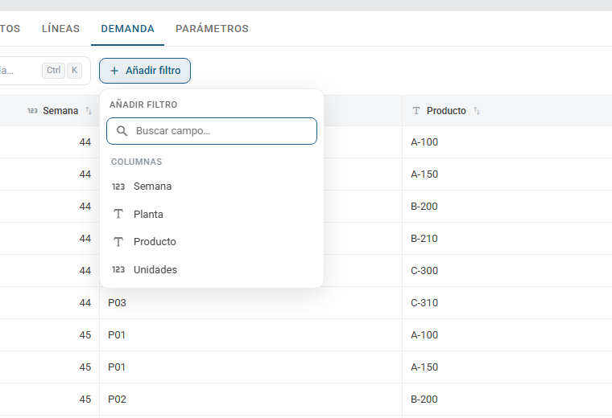
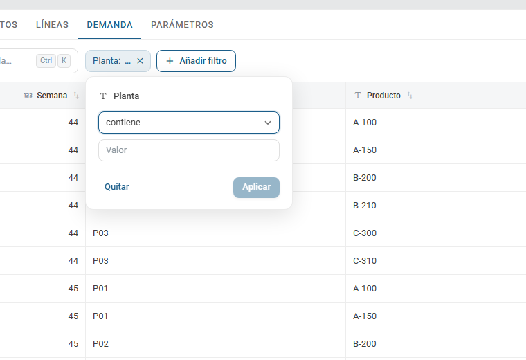

# Tablas de datos

Todas las tablas de la aplicación funcionan igual: los datos de entrada y los resultados de una ejecución, las tablas de configuración, la revisión de una ejecución nueva y las comprobaciones. Se buscan, se filtran, se ordenan y se descargan; y las que se pueden editar se editan como una hoja de cálculo.

## Cómo se usa

**Consultar**

- **Buscar**: deja las filas que contienen el texto en cualquier columna (Ctrl+K lleva al buscador).
- **Añadir filtro**: un filtro por columna, según su tipo (texto, rango de números, fechas, lista de valores, sí o no). Cada filtro es un botón que se cambia o se quita.

  

- Pulsar el título de una columna la ordena. Las columnas se ensanchan arrastrando su borde.
- **Densidad** cambia la altura de las filas y **pantalla completa** amplía la tabla.
- El icono de Excel descarga la tabla.
- El pie dice cuántas filas hay y cuántas quedan con los filtros.
- Si una columna tiene descripción, se ve al pasar el ratón por su título.

**Editar** (en las tablas que lo permiten: las de configuración y la revisión de una ejecución nueva)

- Una celda se elige con un clic o con las flechas y se edita escribiendo, con Intro, F2 o doble clic. Suprimir la vacía.
- **Añadir fila** añade una fila nueva. Al marcar filas salen **Edición masiva** (poner un valor en todas a la vez) y **Eliminar**.
- Los cambios no se guardan al momento: quedan **pendientes**, marcados en la tabla y contados en la pestaña y en el pie. **Revisar cambios** abre la lista, desde donde se deshace cada uno o se guardan todos (ver [Tablas de configuración](tablas-de-configuracion.md)).

## Cómo se activa

- **Core.** Siempre está.
- **Qué se puede editar** depende de la tabla: las de configuración, según las operaciones que dé el backend; los datos y resultados de una ejecución, no (salvo con el módulo `recalculation` de enterprise).
- **Columnas**: su orden, su título, su tipo, si son obligatorias y su descripción vienen del esquema de cada tabla. Una columna de sí o no con `pinsRow: true` en el esquema sale como interruptor y resalta las filas marcadas.

## Ver también

- [Tablas de configuración](tablas-de-configuracion.md)
- [Datos de entrada](datos-de-entrada.md)
- [Resultados](resultados.md)
- Referencia técnica: *Data tables* del [README](../README.md#data-tables).
